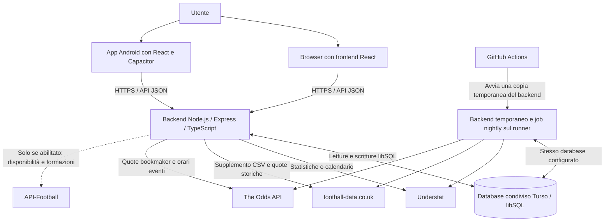
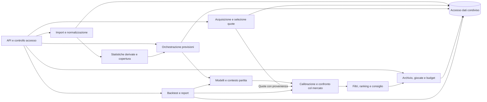
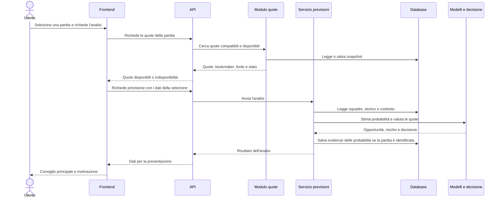
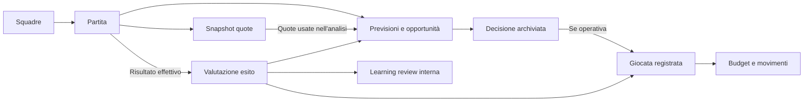

# System design di FootPredictor

Aggiornato al mandato del 29 ottobre 2026: **Nightly Pre-Match Virtual Betting**.
La [guida canonica](operations/nightly-pre-match-2026-10-29.md) definisce
configurazione, gate e attivazione. La nuova nightly A/C e la dashboard sono
implementate localmente, con registrazioni disabilitate per default; non sono
ancora attivate in remoto. Il cutover al Turso personale non è eseguito.

Hostless serve web e API, GitHub Actions svolge l'elaborazione notturna finita,
Turso conserva dati e due portafogli. Non occorre il worker T−15 sempre acceso.
I precedenti [report operativi](operations/production-status-2026-10-29.md)
restano snapshot storici, superati per la direzione di automazione; benchmark
e risultati scientifici non vengono riscritti. C resta Challenger e nessuna
puntata usa denaro reale. Pubblicazione prevista su branch `codex/` e PR,
prima del consenso separato per cutover e attivazione remota.

## 1. Scopo e confini del sistema

FootPredictor è una web app per analizzare partite di calcio prima del loro inizio, confrontare probabilità statistiche con quote bookmaker reali e conservare le decisioni e i risultati.

Il ciclo principale è:

**Dati calcistici → statistiche derivate → probabilità → confronto con quote reali → consiglio → registrazione interna → verifica dell'esito.**

L'app comprende anche budget condiviso, archivio delle opportunità, replay delle partite concluse, backtest e strumenti di controllo dei dati.

L'estensione A/C aggiunge un confronto cronologico tra il nucleo statistico A e
un candidato ibrido CatBoost C, registri di validazione e due portafogli virtuali
separati. I componenti e i limiti di attivazione sono documentati in
[piattaforma sperimentale A/C](research-platform.md). La presenza di codice ML
non dimostra una superiorità predittiva né un'automazione remota attiva.

La registrazione di una giocata modifica il registro e il budget dell'app. Non invia una puntata a un bookmaker e non movimenta denaro esterno. Non è presente un collegamento per eseguire scommesse sui siti degli operatori.

## 2. Architettura generale

Il sistema è un **monolite modulare**: un solo backend contiene moduli con responsabilità distinte. Frontend, backend e database sono separati, ma importazione, previsione, quote e gestione delle giocate appartengono alla stessa applicazione backend.

La copia sul runner GitHub usa lo stesso progetto backend, non un servizio indipendente con una propria logica o un proprio archivio. Serve per svolgere gli aggiornamenti e i calcoli programmati senza dipendere dal processo web ospitato.

| Componente | Responsabilità | Non gli compete |
|---|---|---|
| Frontend React | Navigazione, selezione partita, richiesta di analisi, presentazione di quote, consigli e stato delle operazioni | Accedere direttamente al DB o custodire credenziali dei provider |
| App Android | Eseguire la stessa interfaccia web in un contenitore nativo | Mantenere un bankroll indipendente o un backend separato |
| API Express | Ricevere richieste, controllare accesso e parametri, collegare le funzionalità | Essere il luogo dei modelli statistici |
| Servizi applicativi | Coordinare import, previsioni, quote, archivio, budget e verifiche | Sostituire una quota mancante con una quota bookmaker inventata |
| Modelli statistici e motore decisionale | Stimare probabilità, valutare rischio e opportunità, scegliere il consiglio | Recuperare autonomamente dati dal browser dell'utente |
| Livello database | Persistenza, query, aggiornamenti coerenti e migrazioni dello schema | Decidere quali mercati siano validi come prodotto |
| GitHub Actions | Aggiornamenti, calibrazione, decisioni virtuali A/C opt-in, liquidazioni e controlli CI | Servire l’interfaccia agli utenti |

## 3. Interfaccia e comunicazione con il backend

Le sezioni principali sono:

- **Partite:** calendario, quote e analisi della partita selezionata.
- **Giocate:** registrazioni aperte e storico degli esiti.
- **Budget:** capitale interno, disponibilità e andamento.
- **Archivio giocate:** opportunità operative e salvate a fini di analisi.
- **Backtest:** valutazione storica del modello.
- **Centro dati:** dati importati, fonti, sincronizzazione e integrità.
- **Confronto A/C:** due portafogli A/C, rendimento per periodo, differenze decisionali, benchmark probabilistico separato e stato nightly.
- **Glossario:** spiegazione dei termini mostrati nell'app.

Il frontend comunica tramite richieste HTTP con risposte JSON. Le operazioni interattive ricevono la risposta dal backend; lo stato generale viene aggiornato anche con controlli periodici. Non è previsto un canale WebSocket per gli aggiornamenti in tempo reale.

Il browser conserva preferenze locali come il tema. Budget, giocate, opportunità e dati calcistici risiedono nel database condiviso. Due dispositivi vedono quindi gli stessi dati applicativi dopo il loro aggiornamento, se usano lo stesso backend e lo stesso utente condiviso.

Le cache del frontend evitano richieste identiche ravvicinate; il caricamento di più viste può condividere una richiesta già in corso. Le scritture pertinenti invalidano le letture memorizzate.

## 4. Moduli logici del backend

Gli archi rappresentano dipendenze e passaggi di dati logici, non processi separati. Il modulo quote e quello previsioni sono coordinati dalle richieste applicative: il modello non deve conoscere le credenziali del provider.

| Modulo | Ruolo nel sistema |
|---|---|
| Import e normalizzazione | Trasforma le informazioni delle fonti in squadre, partite e statistiche coerenti con l'archivio interno |
| Statistiche derivate | Calcola medie, variabilità, copertura storica e profili utili ai modelli |
| Contesto della partita | Combina informazioni disponibili su squadre, calendario, arbitro e, quando abilitati, giocatori e assenze |
| Previsioni | Coordina caricamento dati, modelli, calibrazione, analisi delle quote e costruzione del risultato |
| Quote | Abbina gli eventi, normalizza mercati e selezioni, mantiene bookmaker, orario e fonte |
| Decisione | Filtra mercati non ammessi o fragili e ordina le opportunità in base a probabilità, quota, rischio e qualità dei dati |
| Archivio e budget | Collega analisi, decisioni, registrazioni e risultato economico interno |
| Validazione e learning | Esegue backtest e confronti post-partita; mantiene le analisi tecniche interne |
| Osservabilità | Raccoglie stato dei job, errori, tempi e stato delle fonti |

## 5. Fonti e importazione dei dati

### 5.1 Fonti distinte per responsabilità

| Fonte | Dati utilizzati | Regola principale |
|---|---|---|
| Understat | Squadre, calendario, risultati, xG, tiri e dati giocatore quando abilitati | Fonte primaria dei dati calcistici |
| football-data.co.uk | CSV con statistiche supplementari e quote storiche di apertura/chiusura disponibili | Riempie statistiche mancanti senza sovrascrivere quelle Understat; le quote hanno provenienza separata |
| The Odds API | Quote espresse dai bookmaker, eventi e relativi orari | Unico provider quote del runtime corrente; la disponibilità dipende da copertura e credenziali |
| API-Football | Rose, indisponibilità e formazioni nel percorso opzionale | Richiede abilitazione e configurazione; il percorso è in pausa per default |
| Riferimenti delle competizioni | Identità, stagioni e passaggi tra competizioni | Supportano integrità e contesto delle neopromosse; non sbloccano automaticamente nuovi mercati |

FotMob, Transfermarkt, FBref e lo scraper supplementare SofaScore non fanno parte del flusso dati attivo descritto qui.

### 5.2 Flusso di import

1. Si identifica la competizione e la finestra delle stagioni da mantenere: stagione corrente e quattro precedenti.
2. Understat fornisce le identità principali e i dati delle partite, distinguendo concluse e future.
3. Il sistema normalizza nomi, identificativi e date e aggiorna i record già esistenti.
4. Il supplemento CSV viene abbinato per data e alias squadra. Completa solo i campi statistici mancanti; conserva separatamente le quote storiche.
5. Si controlla la copertura, si aggiornano le statistiche derivate delle squadre coinvolte e si invalidano le cache interessate.
6. I risultati nuovi consentono di chiudere le previsioni e le giocate valutabili.

Gli aggiornamenti sono progettati per poter essere ripetuti: una partita già importata viene riconosciuta e aggiornata, evitando duplicazioni per la stessa identità. Le righe immutate vengono escluse dalle scritture dove previsto. La retention può eliminare partite fuori dalla finestra; dopo tale operazione le medie devono essere ricalcolate per non usare lo storico rimosso.

La presenza di un campo nel modello dati non prova che la fonte lo fornisca per ogni lega. In particolare, il supplemento non fornisce il possesso e la copertura dell'arbitro non è uniforme.

## 6. Quote: acquisizione, provenienza e disponibilità

Il recupero quote parte da una partita interna. Il sistema cerca l'evento corrispondente presso il provider usando squadre, competizione e orario; quindi collega le selezioni offerte ai mercati interni.

Uno **snapshot** è una fotografia delle quote raccolte in un determinato momento. Conserva il collegamento alla partita, la fonte, i bookmaker e i mercati disponibili. Snapshot diversi consentono di distinguere ciò che era disponibile in momenti diversi.

Possono essere usate quote di più bookmaker, mantenendo il bookmaker effettivo per ciascuna selezione. Il provider che trasporta il dato e il bookmaker che esprime la quota sono due soggetti distinti.

Prima di chiamare il provider, il percorso della singola partita può riutilizzare cache e snapshot compatibili, secondo le regole di freschezza applicabili. Se il provider non trova l'evento o il mercato richiesto, quel dato resta indisponibile: non esiste un secondo provider quote attivo come fallback.

Tutte le richieste HTTP a The Odds API attraversano ora un gestore persistente
nel medesimo database libSQL/Turso. Prima del trasporto prenota il costo stimato,
riusa una risposta ancora valida oppure acquisisce una lease esclusiva della
richiesta. La chiave normalizzata comprende endpoint e parametri, senza secrets.
Ciò condivide raccolta, budget e deduplicazione fra UI e job nightly,
anche dopo un riavvio o fra istanze concorrenti. Nessuna transazione DB resta
aperta durante la chiamata HTTP. I risultati conservano costo osservato negli
header, stime prudenziali quando manca, timestamp originari e motivo dei blocchi.

La migrazione additiva `018_smart_odds.sql` aggiunge registro richieste/risultati,
budget, cache, lease ed eventi. Il limite locale di pianificazione è 500 crediti
al mese, con riserva di 50 per le richieste essenziali: non è una misura del
residuo dell'account. Il consumo osservato resta sconosciuto fino agli header.
Il mese UTC è una convenzione locale; il reset del provider deve essere
riconciliato con una verifica gratuita, senza ricarica presunta.

Per default la UI è cache-only e `RUN_ODDS_SYNC=false` disabilita la raccolta
informativa generale. Il job A/C opt-in usa il canale essenziale separato:
`h2h`, `totals` e `spreads`, una regione e snapshot condivisi per lega/finestra.
Entrambi i modelli vedono gli stessi prezzi, con bookmaker e provenienza reali.
Il calendario usa eventi gratuiti, senza richiedere prezzi o scores per il kickoff.

L'età massima iniziale della quota è 300 secondi alla decisione notturna,
controllando acquisizione e aggiornamento originario; non è un requisito di
quota a cinque minuti dal calcio d'inizio. Cache informativa di trenta minuti
non autorizza una decisione con prezzi scaduti. Budget insufficiente o assenza
di quota reale provocano astensione, senza abbassare la freschezza.

La proiezione `forecastRemainingNightlyOddsDemand` raggruppa lega/finestra
03:00 Roma, gestisce DST e mese contabile UTC ed esclude leghe senza incontri
previsti. È una stima, distinta dai crediti osservati dal provider. Il caso
teorico di cinque leghe per 31 notti costa 465 crediti; con 16 richieste retry
sale a 513 e richiede esclusioni entro il limite 500. Le precedenti stime
T−15 restano storiche. La [gestione quote](operations/smart-odds-2026-10-27.md)
distingue i due metodi e non garantisce copertura integrale gratuita.

Il sistema contiene anche stime e completamenti prodotti dal modello per analisi interne o replay. Questi non costituiscono quote bookmaker reali e non possono dimostrare convenienza, ROI o qualità rispetto al mercato. La UI deve distinguere gli stati e mostrare come indisponibile una quota reale assente.

## 7. Dalla partita al consiglio

Il processo decisionale ha questi passaggi:

1. **Preparazione:** recupera i dati delle due squadre, lo storico, la copertura e il contesto disponibile.
2. **Contesto:** gli input disponibili adattano l'analisi alla partita. Dati assenti o campioni deboli non vengono trattati come informazioni certe.
3. **Stima:** il modello Dixon-Coles descrive i goal delle squadre e i risultati possibili; un modello Poisson basato sugli xG contribuisce alle probabilità dei mercati goal. Modelli dedicati trattano statistiche come tiri e cartellini.
4. **Calibrazione:** le probabilità vengono corrette usando previsioni storiche prodotte in ordine temporale, per ridurre gli scostamenti sistematici dalle frequenze osservate.
5. **Confronto col mercato:** il sistema considera le quote reali, il margine del bookmaker e il blending, cioè la combinazione controllata tra stima statistica e informazione del mercato.
6. **Filtri e rischio:** valuta convenienza attesa, incertezza, copertura e fragilità. Calcola anche una proposta di importo rispetto al budget, con limiti prudenziali.
7. **Scelta finale:** seleziona un consiglio principale sui mercati squadra, con motivazione breve, oppure segnala che non ci sono condizioni adeguate per una giocata operativa.

La probabilità di un risultato, la convenienza di una quota e la certezza di vincere sono concetti diversi. Il sistema produce stime e decisioni condizionate ai dati disponibili; l'architettura non implica una redditività dimostrata.

### 7.1 Mercati e moduli opzionali

- I mercati squadra comprendono esito, doppia chance, draw no bet, goal/over-under, entrambe a segno, handicap e, con copertura sufficiente, tiri, tiri in porta e cartellini totali.
- Per i cartellini totali l'unità di confronto è **gialli + due volte i rossi**, coerente con il mercato corrispondente.
- Il risultato esatto contribuisce alle probabilità e alle analisi interne; non è un mercato bookmaker operativo richiesto.
- Corner e falli restano esclusi dalla selezione operativa, anche quando esistono statistiche o stime interne.
- Le player props, cioè mercati sul singolo giocatore, sono un percorso distinto: richiedono dati abilitati, campione sufficiente, identificazione non ambigua e una quota reale per giocatore, mercato e linea.
- L'import dei giocatori e il percorso disponibilità/formazioni sono disattivati per default. La loro presenza nel progetto non significa che siano attivi nel deploy.

### 7.2 Addestramento e uso dei modelli

L'addestramento, chiamato anche **fit**, stima i parametri dei modelli dalle partite concluse di una competizione. È un'operazione distinta dalla previsione della singola partita: il flusso di aggiornamento dati può eseguirla dopo l'import e il sistema conserva i parametri nel database.

Il servizio previsioni carica i parametri salvati e li riusa in memoria. Non avvia un nuovo addestramento completo a ogni clic dell'utente. L'assenza di parametri o di un partner Poisson compatibile può attivare comportamenti di base o ridurre l'ensemble: la possibilità di ottenere una risposta non dimostra che un modello sia addestrato e validato sulla competizione scelta.

La calibrazione è un'elaborazione diversa: costruisce correzioni da previsioni storiche cronologiche e le conserva in profili compatibili. Preparare questa cache anticipatamente non equivale a importare dati nuovi o a registrare giocate.

### 7.3 Percorso sperimentale A/C

`ForecastCore` ricostruisce il nucleo A dal solo passato ammissibile e produce
feature comuni per training, benchmark e inferenza. `CatBoostModel` carica
gli alberi JSON del candidato C e deriva una distribuzione congiunta dei gol.
`ResearchProbabilityPipeline` conserva il protocollo V1 come evidenza storica.
Il percorso decisionale usa `CoherentProbabilityPipeline`, con protocollo
versionato `joint-goal-coherent-v2`: calibra una partizione 1X2 normalizzata,
riproietta la distribuzione dei gol e deriva tutte le probabilità e l'EV
dalla stessa matrice finale. Conserva separatamente raw, calibrate,
decisionali e bookmaker. I calibratori V1 non vengono riutilizzati come V2.
`ProbabilityConfiguration` identifica anche modalità, temperatura e calibratore
del post-processing. La validazione di mercato è legata a questo descrittore/hash,
non alla sola versione raw del modello. Una configurazione nuova o mancante
non eredita le approvazioni precedenti, anche quando la versione A resta uguale.
La baseline ricostruita non equivale a ogni stato mutabile dell'analisi live:
manifest e report esplicitano le differenze, inclusa la matrice ausiliaria A.

`ResearchEvaluation` confronta A/C con input e condizioni uguali, metriche
appaiate e test cronologico separato. `ResearchLifecycle` conserva candidati,
valida l'ultimo holdout e può promuovere o ripristinare versioni solo con
evidenze prestabilite. La policy protegge le 745 partite finali già osservate
e richiede un nuovo periodo futuro per le promozioni; tre retry dello stesso
snapshot non bastano come controlli operativi. La promozione del modello è distinta dall'abilitazione
di un mercato. In assenza di evidenze il mercato resta sperimentale. La nuova simulazione
nightly può ammetterlo solo con idoneità tecnica verificata, senza promuoverlo
o considerare dimostrata una redditività.
Modalità, temperatura e hash della configurazione effettiva restano espliciti
nei report e nelle prove operative, senza ricorrere a un calibratore implicito.

Il training CatBoost avviene tramite comando Python locale o workflow
settimanale. L'inferenza web resta nel monolite TypeScript; non viene aggiunto
un microservizio ML. `ResearchRuntime` fornisce preparazione, probabilità e snapshot al job finito
`ResearchNightly`, al settlement e al monitoraggio. Il precedente T−15 resta
codice di compatibilità, non un processo richiesto. La sezione Confronto A/C legge lo stesso
database; non simula saldi nel telefono.

`ResearchProspectiveEvidence` aggiunge raccolta prepartita e risultati
append-only con la migrazione additiva 021. Congela osservazioni anche sulle
astensioni, senza creare puntate o movimenti del ledger; le risolve soltanto quando il
risultato ufficiale è realmente osservato. La partizione nominale 80/20 usa
l'hash della partita, comune per A/C: `FUTURE_TEST` non entra nei campioni
prudenziali. Si riutilizzano soltanto osservazioni `CALIBRATION` già risolte e
compatibili con versione, artefatto e configurazione al momento della nuova
previsione. Nessun refit, calibrazione ricostruita o promozione implicita.

Il registro iniziale non contiene campioni ammissibili: anche con inferenza
corretta e quote reali, i gate di almeno 50 partite per mercato/fascia e
Hoeffding possono imporre astensione. Non è richiesta una redditività già
dimostrata per raccogliere osservazioni, ma non si forza una BET per iniziare
il confronto. Vedi il [riscontro runtime](operations/nightly-model-runtime-2026-10-29.md).

Il registry `research_experiments`, aggiunto dalla migrazione 017, conserva
separatamente diagnosi e confronti di sviluppo. I relativi artefatti restano
incompatibili con la selezione runtime e non diventano candidati operativi
soltanto perché sono consultabili nella scheda Esperimenti.

## 8. Dati persistenti e relazioni

Il database libSQL/Turso è il punto di condivisione tra interfaccia web, Android e processi programmati. Non viene creato un database per ciascun dispositivo.

| Gruppo di dati | Contenuto e collegamenti |
|---|---|
| Squadre, partite e stagioni | Identità calcistiche; ogni partita collega casa, trasferta, competizione, stagione e risultato |
| Statistiche derivate | Medie, variabilità, copertura e profili di squadre, arbitri e, se abilitati, giocatori |
| Parametri dei modelli | Parametri addestrati per competizione e riferimento temporale, ricaricabili dal servizio previsioni |
| Quote storiche e snapshot | Prezzi, mercati, timestamp e provenienza associati alla partita |
| Previsioni e opportunità | Selezioni analizzate, probabilità, quote usate, classificazione e versioni pertinenti |
| Decisioni archiviate | Collegamento tra opportunità e scelta operativa oppure semplice salvataggio |
| Giocate e budget | Importi registrati, quota, esito, ritorni e movimenti del capitale interno condiviso |
| Backtest e learning review | Report di validazione e confronti post-partita |
| Cache di calibrazione | Profili riutilizzabili con impronta di dati, configurazione e codice |
| Sessioni e job | Sessioni amministrative e traccia persistente delle esecuzioni programmate |
| Riferimenti tra competizioni | Identità e passaggi di squadra utili ai controlli e ai percorsi previsti |
| Registry e benchmark A/C | Artefatti, hash, metriche, holdout, Champion e transizioni versionate |
| Mercati della ricerca | Stato ed evidenze per famiglia/versione/mercato, separati dalla promozione del modello |
| Job e input prepartita | Finestra nightly, kickoff UTC, lease, motivi di astensione e snapshot condivisi; vecchi record T−15 preservati |
| Esecuzioni nightly A/C | Migrazione additiva 020: finestra e policy persistenti, lease, retry e riepilogo del job |
| Portafogli A/C | Due ledger indipendenti, ID storici preservati e nessun nuovo main o fusione con il budget legacy |
| Monitoraggio della ricerca | Incidenti deduplicati e riepiloghi quotidiani nell'app; canale esterno non configurato |
| Esperimenti diagnostici | Configurazioni e risultati di sviluppo con hash/versioni, separati dai candidati runtime e non promuovibili |

Questo è un modello concettuale delle relazioni, non uno schema SQL: alcuni collegamenti sono conservati anche nei payload archiviati. I record legacy possono avere collegamenti o metadati incompleti.

L'audit interno conserva anche probabilità scartate dai filtri o prive di quota. L'archivio delle opportunità comprende invece le decisioni effettivamente registrate o salvate: calcolare una probabilità non significa proporre o registrare una giocata.

Le migrazioni versionate aggiornano lo schema all'inizializzazione del backend. Gli aggiornamenti delle giocate e del budget usano operazioni atomiche per mantenere coerenti registrazione e capitale interno.

## 9. Giocate, automazione e chiusura degli esiti

### 9.1 Portafogli A/C e storico legacy

Il confronto A/C non espone registrazioni manuali: il solo percorso nuovo è
la nightly. I due portafogli esistenti `shadow_A` e `shadow_C` conservano gli
ID storici, i ledger e il capitale; non rappresentano una modalità Shadow
Betting aggiuntiva. Non viene creato un terzo portafoglio. Le API manuali del
budget legacy, fra cui `/bets/place`, appartengono al sistema precedente e
non sono invocate per le registrazioni notturne A/C.

Il settlement liquida soltanto giocate già registrate quando i dati necessari
sono disponibili. Rimborsi, mezzi esiti e risultati incompleti mantengono le
regole implementate; storico e saldi legacy restano separati.

### 9.2 Nightly Pre-Match Virtual Betting

La route legacy automatica `/api/automation/place-valid-bets` rimane ritirata
con `410`; `AUTO_BET_*` non abilita la nuova nightly. Il job finito usa i servizi
esistenti direttamente sul runner GitHub, dopo sincronizzazione e gate dati.

La finestra parte dall'avvio effettivo e arriva alla successiva nightly delle
03:00 Europe/Rome, oppure usa una durata configurata. Orario legale, ritardi,
rinvii e cambi di kickoff non autorizzano una puntata retroattiva. Il kickoff
viene ricontrollato nel commit, senza nuova registrazione dopo l'inizio.

A/C usano lo stesso snapshot dati e quote. Ogni modello può scegliere una
puntata oppure nessuna. Con 1.000 euro iniziali per portafoglio, lo stake è
1% del patrimonio contabile e l'esposizione aperta massima 5%; una sola
puntata per partita/modello. Selezione deterministica, lease persistenti e
vincoli univoci proteggono retry e workflow concorrenti senza doppio impegno.

`EXPERIMENTAL` non impedisce da solo la simulazione virtuale: restano
obbligatori dati e probabilità coerenti, prezzo reale identificato, timestamp,
liquidazione, capitale e controlli tecnici. Validazione statistica e promozione
restano separate; C non diventa Champion perché guadagna nel periodo.
`RESEARCH_NIGHTLY_ENABLED=false` è il default; attivazione remota ancora
pendente. Nessun percorso di questo confronto invia puntate ai bookmaker.

## 10. Replay, archivio e backtest

| Percorso | Domanda a cui risponde | Limite da conservare |
|---|---|---|
| Archivio | Che cosa era stato salvato o registrato, con quali dati e quale esito? | Dipende dalla completezza e dai timestamp dei record realmente presenti |
| Replay | Che analisi ricostruisce il sistema per una partita già conclusa? | Non prova quale consiglio fosse effettivamente disponibile prima della partita |
| Backtest | Come si comporta una configurazione su una sequenza storica? | È una valutazione simulata, distinta dalle giocate registrate prima del calcio d'inizio |

Il replay usa, quando disponibili e ammesse, quote bookmaker archiviate. In loro assenza può produrre un replay statistico con quote stimate dal modello, marcato con una provenienza distinta. Tali quote non costituiscono evidenza di value o rendimento contro il mercato reale. Il replay può inoltre salvare una learning review: una richiesta di analisi non è necessariamente priva di scritture.

Il backtest supportato segue il metodo **walk-forward**: procede nel tempo, addestra sui dati ammessi prima del target e valuta il periodo successivo. I percorsi cronologici applicano regole di disponibilità temporale ai risultati e alle informazioni supplementari, per evitare di usare il futuro per prevedere il passato.

Il lavoro pesante del backtest viene eseguito in un worker thread, cioè un thread di calcolo separato all'interno dell'applicazione Node. È ammesso un backtest alla volta per istanza del servizio, con timeout e rifiuto delle richieste concorrenti. Non è una coda distribuita e non è un microservizio.

Le learning review confrontano probabilità, consiglio ed esito. I moduli di apprendimento e tuning sono strumenti interni e condizionati alla configurazione; non implicano che ogni aggiornamento produca un miglioramento o che il modello si riaddestri autonomamente con risultati garantiti.

## 11. Aggiornamenti programmati

GitHub Actions rimane l'orchestratore. Il workflow usa `0 1 * * *` e
`0 2 * * *` UTC con gate sul trigger originale, per eseguire quello corretto
alle 03:00 Europe/Rome in estate/inverno. Concurrency e lease DB evitano
duplicazioni; GitHub può comunque ritardare o saltare un job.

Il flusso mantiene import Understat, supplemento HTTP/CSV consentito,
normalizzazione, calendari, risultati, liquidazioni legacy e A/C e preparazione
calibrazione. Dopo i gate, se abilitato, lo script `research-nightly.js` carica
A/C, raccoglie prezzi essenziali, decide, registra e aggiorna i portafogli.
Learning review e stato finale restano distinti dai requisiti di ammissione.
Un gate fallito impedisce nuove decisioni su dati non idonei; i risultati
precedenti non vengono cancellati. I dettagli sono nella
[guida nightly](github-actions-nightly-sync.md).

Il backend web usa `NIGHTLY_ORCHESTRATOR=github_actions` e non ripete gli
scheduler interni. `RESEARCH_T15_SCHEDULER_ENABLED=false` rimane impostato;
non occorrono worker Hostless, polling ogni 15 secondi o heartbeat per
l'ammissione delle nuove puntate. Il vecchio watchdog Hostless è in pausa.
La richiesta di pausa standalone è stata accettata, ma lo stato effettivo
non è ancora confermato. Nessun servizio è stato eliminato.

Il nuovo monitor osserva ultima nightly, esito, conteggi, errori, crediti e
liquidazioni. Il controllo GitHub indipendente non richiede un worker attivo;
il controllo DB è un opt-in con credenziale dedicata di sola lettura.
I riepiloghi giornalieri in-app sono visibili dalle 09:00 Europe/Rome, senza
notifiche per ogni puntata. Una notifica salvata non prova consegna esterna.

Training settimanale, promozione condizionata e rollback restano separati dal
job giornaliero. `Prepare prediction calibration` calcola i profili sul runner
e li salva nel DB, senza chiamare provider quote o registrare puntate. Il suo
trigger su `main` rende necessario pianificare prima il cutover: si prepara un
branch `codex/` e PR, non un push prematuro. CI, build e unit test non provano
pubblicazione o funzionamento remoto della nuova architettura.

## 12. Cache e prestazioni

L’[audit locale Turso/CPU](operations/turso-cpu-audit-2026-10-29.md) distingue
riduzione dei payload e UPDATE inutili dalle righe fatturate dal provider.
Queste misure offline non provano risoluzione del CPU throttling Hostless.

Il sistema usa cache locali e una cache persistente specifica, senza un servizio Redis o un message broker dedicato.

| Livello | Che cosa evita | Validità e limiti |
|---|---|---|
| Frontend | Ripetere letture identiche e richieste simultanee uguali | Durata limitata e invalidazione dopo operazioni pertinenti |
| Backend in memoria | Rileggere riepiloghi, copertura, quote, modelli e input di calibrazione | Ogni processo ha la propria cache; il riavvio la svuota |
| Snapshot e archivio | Recuperare di nuovo informazioni già conservate, quando riutilizzabili | Devono rispettare provenienza, compatibilità e freschezza |
| Cache persistente di calibrazione | Ricalcolare sul servizio web profili già preparati dal runner | Riuso solo con impronta compatibile di dati ammessi, impostazioni e codice |

Se un profilo manca, è danneggiato o non è compatibile, il backend ricalcola la calibrazione completa. Questo preserva la correttezza ma può rendere più lenta la prima previsione. La preparazione anticipata riduce questo costo senza accettare profili obsoleti.

Le scritture del processo locale invalidano le cache interessate dove previsto. Le modifiche eseguite da un altro processo possono diventare visibili solo alla scadenza della cache: database condiviso non significa cache condivisa o aggiornamento istantaneo.

Batch di lettura/scrittura, aggiornamento delle sole squadre coinvolte e richieste quote mirate riducono rete e lavoro ripetuto. Non dimostrano da soli una riduzione delle righe fatturate o il rispetto delle quote del provider: questi aspetti richiedono misure operative.

## 13. Accesso e sicurezza

Il prodotto usa un accesso amministrativo condiviso e un'identità dati canonica per budget e giocate, normalmente `user1`. Non è progettato come servizio pubblico con account e portafogli indipendenti per ogni utente.

Il login verifica una password tramite hash e genera una sessione. Nel DB viene conservato l'hash del token di sessione; il dispositivo riceve un cookie non accessibile al JavaScript della pagina. In produzione i cookie richiedono una connessione sicura e la password configurata è obbligatoria.

Il backend controlla le origini autorizzate, limita i tentativi di login e
protegge le operazioni amministrative. Le chiamate interne usano i meccanismi
dedicati alla manutenzione. La route legacy di registrazione automatica è
ritirata e risponde sempre 410; non avvia decisioni né richiede una sessione
browser. Il job nightly usa direttamente il database con i secret del runner,
mai quelli del frontend. L'healthcheck essenziale resta pubblico.

Le chiavi del database e dei provider restano nell'ambiente backend o nei GitHub Secrets. Le variabili frontend vengono incluse nella build: non devono contenere credenziali riservate. L'APK contiene interfaccia e configurazione di collegamento, non un'autorizzazione permanente alle API.

## 14. Esecuzione e distribuzione

| Ambiente | Frontend | Backend | Persistenza |
|---|---|---|---|
| Sviluppo locale | Server React con proxy API | Processo Node locale | Database libSQL configurato |
| Docker Compose | Build React servita da Nginx sulla porta locale 3000 | Container Node sulla porta 3001 | Database libSQL/Turso configurato nell'ambiente |
| Hosting web previsto dalla configurazione | Servizio frontend, eventualmente con URL API esplicito nella build | Servizio backend separato | Database condiviso configurato |
| Android | Asset React inclusi nell'APK tramite Capacitor | Stesso backend remoto della versione web | Stesso database attraverso le API |
| GitHub Actions | Nessuna UI | Processo temporaneo sul runner | Stesso database indicato dai secrets |

In Compose, Nginx serve gli asset e inoltra le richieste `/api` al backend; il frontend parte dopo il superamento dell'healthcheck del backend. Non è presente un container database nello stack Compose corrente.

Per browser e Android la destinazione API dipende dalla configurazione della build. Il client Android ha anche un indirizzo Hostless predefinito. Questi riferimenti descrivono il collegamento previsto, non una verifica di disponibilità dell'hosting.

La [migrazione Turso personale](operations/turso-personal-migration-2026-10-29.md)
ha completato import e confronto integrale della copia iniziale via CLI:
schema, conteggi e hash coincidono, integrità `ok` e zero violazioni FK.
La parità riguarda gli snapshot, non lo stato live; cutover non eseguito.
Il piano Starter gratuito ha overage disabilitati, verificati via CLI. Tutti i processi devono usare lo stesso database dopo il passaggio
coordinato; servono conferme separate per cutover e attivazione delle nuove
registrazioni. Non basta modificare i secret della sola nightly.

Il comando di avvio completo previsto è `docker compose up -d --build`. L'endpoint essenziale è `http://localhost:3001/api/health`. HTTPS esterno, DNS e modalità di deploy dipendono dall'ambiente scelto.

## 15. Errori, osservabilità e limiti operativi

| Situazione | Comportamento o confine previsto |
|---|---|
| Statistiche mancanti o campione ridotto | Qualità e disponibilità influenzano mercati, confidenza e decisione; non si presume copertura completa |
| Evento o quota reale assente | Segnalazione di indisponibilità; niente attribuzione di una quota sintetica a un bookmaker |
| Database non raggiungibile | Le funzionalità che richiedono dati o scritture possono fallire; non c'è un archivio operativo offline separato sul telefono |
| Cache di calibrazione inutilizzabile | Ricalcolo completo, con possibile aumento dei tempi |
| Backtest concorrente o troppo lungo | Rifiuto della seconda elaborazione per istanza oppure termine per timeout |
| Import parzialmente fallito | Stato di errore e conteggi delle scritture confermate; non si presume un rollback globale dell'intero import |
| Controlli obbligatori nightly falliti | Il run rimane fallito e i passaggi dipendenti devono rispettare i gate |
| Risultato insufficiente per il settlement | Record ancora non risolto invece di un esito inventato |

Gli identificativi delle richieste e delle esecuzioni, i log e i record dei job permettono di collegare operazioni ed errori. Le API di sistema espongono stato generale, provider, metriche e run recenti.

L'healthcheck essenziale conferma che il processo risponde: non prova freschezza dei dati, copertura quote o corretto completamento della nightly. Questi richiedono controlli separati.

L'architettura dipende da un database condiviso e da provider esterni. Non documenta un cluster con alta disponibilità, una coda distribuita o un piano di backup già verificato. Cache, lock e limiti di concorrenza locali non coordinano automaticamente più repliche del backend. Prima di aumentare le istanze servirebbe verificare questi confini.

## 16. Scelte architetturali e conseguenze

| Scelta | Motivo | Conseguenza |
|---|---|---|
| Monolite modulare | Mantenere semplice lo sviluppo e il collegamento tra dati, modelli e budget | I moduli condividono il ciclo di rilascio e parte delle risorse del processo |
| Web-first con Android Capacitor | Riutilizzare interfaccia e logica applicativa | Le funzioni principali del telefono richiedono il backend raggiungibile |
| libSQL/Turso condiviso | Unificare dati tra dispositivi e job senza un DB locale separato per ogni client | Costi, latenza e disponibilità del DB incidono sui percorsi principali |
| Nightly sul runner | Separare il lavoro periodico dal servizio che risponde agli utenti | Le scritture esterne richiedono attenzione alla freschezza delle cache |
| Provenienza esplicita delle quote | Separare prezzi reali da stime del modello | Un mercato può restare non disponibile anche se la probabilità è calcolabile |
| Calibrazione persistente compatibile | Riutilizzare il lavoro senza alterare il protocollo statistico | Nuovi dati o configurazioni possono richiedere calcoli completi |
| Backtest in worker | Limitare l'impatto del calcolo sulla risposta HTTP | Le risorse restano condivise sulla stessa macchina; non è scalabilità distribuita |

## 17. Riferimenti e verifica del documento

Questa è la lettura d'insieme dell'app. Gli altri documenti approfondiscono singoli aspetti:

- [README](../README.md): ingresso al progetto e comandi principali.
- [Formulario](FORMULARIO-sistema-scommesse.md): dettagli matematici e configurazione dei modelli.
- [Nightly GitHub Actions](github-actions-nightly-sync.md): ordine operativo, gate e configurazione dei job.
- [Android privato](android-private-apk.md): distribuzione e collegamento dell'APK.
- [Transizioni tra competizioni](competition-transitions/README.md): riferimenti e limiti dei dati.
- [Piattaforma A/C](research-platform.md): ML, benchmark, mercati, portafogli e nightly opt-in.

I principali riscontri per mantenere questo documento aggiornato sono:

| Aspetto | Fonti nel repository |
|---|---|
| Schermate e comunicazione | [App React](../frontend/src/App.tsx), [client API](../frontend/src/utils/api.ts), [Capacitor](../frontend/capacitor.config.ts) |
| Ingresso backend e accesso | [Avvio backend](../backend/src/index.ts), [autenticazione](../backend/src/security/SharedAdminAuth.ts), [API](../backend/src/api/routes.ts) |
| Dati e import | [Database](../backend/src/db/DatabaseService.ts), [migrazioni](../backend/migrations), [Understat](../backend/src/services/UnderstatScraper.ts), [supplemento CSV](../backend/src/services/FootballDataService.ts) |
| Previsioni e decisioni | [Servizio previsioni](../backend/src/services/PredictionService.ts), [contesto](../backend/src/services/PredictionContextBuilder.ts), [motore decisionale](../backend/src/models/value/ValueBettingEngine.ts) |
| Quote e provenienza | [Configurazione provider](../backend/src/services/odds-provider/providerRuntimeConfig.ts), [coordinatore](../backend/src/services/odds-provider/OddsProviderCoordinator.ts), [selezione quote](../backend/src/services/BookmakerOddsSelectionService.ts) |
| Automazione e calcoli | [Pianificatore](../backend/src/services/AutomatedBetPlanningService.ts), [worker backtest](../backend/src/services/HeavyJobService.ts), [previsioni cronologiche](../backend/src/services/ChronologicalForecastService.ts) |
| Job e deployment | [Compose](../docker-compose.yml), [Nginx](../frontend/nginx.conf), [nightly](../.github/workflows/nightly-sync.yml), [script nightly](../scripts/ci/nightly-sync.sh), [warm calibrazione](../.github/workflows/calibration-warm.yml), [CI](../.github/workflows/ci.yml) |

Per verificare questa descrizione in modo ripetibile occorre confrontare: servizi effettivamente avviati, route raggiunte dalla UI, dipendenze tra moduli, gruppi di dati persistiti, flag predefiniti e sequenza dei workflow. I diagrammi rappresentano questi riscontri, non componenti futuri della roadmap.

Per questa revisione sono stati controllati sorgenti, configurazioni e riferimenti locali. Non sono stati avviati import, backtest, job, container o chiamate al database/provider: la modifica riguarda solo la documentazione e non misura prestazioni, disponibilità o rendimento delle previsioni.
