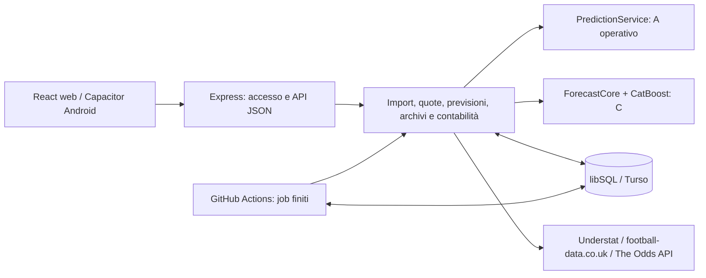

# Architettura di FootPredictor

Questa guida descrive codice e configurazioni del repository. Non certifica quale revisione sia distribuita, quali flag remoti siano abilitati, quale modello sia selezionato nel database o quando sia riuscita l'ultima Nightly. Questi fatti richiedono riscontri dell'ambiente interessato.

## Componenti e responsabilità

FootPredictor è un monolite modulare: React presenta i dati, Node.js/Express/TypeScript coordina servizi e modelli, libSQL/Turso conserva lo stato condiviso. Non ci sono microservizi ML, Redis o un broker di messaggi. Android include il frontend tramite Capacitor e usa le stesse API.

La separazione è logica, nello stesso backend. La Nightly avvia sul runner un'istanza temporanea del backend per la manutenzione e usa gli stessi moduli per confronto e registrazioni virtuali. Python/CatBoost serve al training separato; l'inferenza C valuta alberi JSON nel processo Node.

Fonti: [avvio](../backend/src/index.ts), [API](../backend/src/api/routes.ts), [servizio A](../backend/src/services/PredictionService.ts), [runtime C](../backend/src/research/ResearchRuntime.ts), [CatBoost](../backend/src/research/CatBoostModel.ts).

## App e richieste

La navigazione principale comprende Partite, Giocate e Budget; Archivio e Dati e aggiornamenti sono fra gli strumenti. Backtest, Research e viste interne dei dati restano raggiungibili dalle rispettive route. Research riguarda benchmark e modelli; la contabilità A/C si consulta nelle pagine normali.

Il dettaglio si apre su Analisi sportiva. La prima lettura delle quote usa la cache. Nella scheda Giocate A e C, senza quote sufficientemente recenti, un componente dedicato può richiederle automaticamente al provider con `requestNetwork: true`. Conserva un tentativo per partita per cinque minuti e permette un nuovo tentativo manuale. La richiesta può consumare crediti; aprire una schermata non registra una puntata.

A usa `POST /api/predict/jobs` e `GET /api/predict/jobs/:id`: il calcolo resta quello di `PredictionService`. I job sono temporanei e in memoria; un riavvio può interromperne il recupero. Restano disponibili `/api/predict` e `/api/predict/replay`.

I consigli A/C archiviati hanno precedenza nella presentazione. Senza una decisione C archiviata, `POST /api/research/challenger-preview` può produrre un'anteprima corrente. Il servizio di anteprima usa solo quote in cache: non abilita autonomamente la rete, non registra giocate o prove prospettiche. L'acquisizione della scheda Giocate è un percorso distinto.

Fonti: [navigazione](../frontend/src/App.tsx), [dettaglio](../frontend/src/components/predictions/PredictionWorkbenchView.tsx), [richiesta quote](../frontend/src/components/predictions/MatchQuoteRequest.tsx), [prima lettura](../frontend/src/hooks/useOddsForMatch.ts), [job A](../backend/src/services/PredictionJobService.ts), [anteprima C](../backend/src/research/ChallengerPreviewService.ts).

## Dati, quote e mercati

| Fonte | Ruolo nel codice |
|---|---|
| Understat | Fonte primaria per squadre, partite, risultati, xG e statistiche disponibili |
| football-data.co.uk | Supplemento HTTP/CSV per campi mancanti e quote storiche di chiusura; preserva i valori Understat esistenti |
| The Odds API | Unico provider quote del runtime, con bookmaker, selezione, prezzo e timestamp effettivi |
| API-Football | Disponibilità e formazioni opzionali, disabilitate nei default forniti |

FotMob, Transfermarkt, FBref e lo scraper supplementare SofaScore non sono fonti attive di questo flusso. Copertura e freschezza dipendono da campo, competizione e stagione: un importatore implementato non garantisce dati completi.

Il trasporto quote usa un registro persistente condiviso per cache, prenotazioni, lease, costi e budget. Il limite mensile predefinito è 500 crediti; le richieste informative devono preservarne 50 per quelle essenziali. Questi valori non sono il saldo dell'account. Gli header del provider restano il riferimento per i consumi osservati. Non è configurato un secondo provider come fallback.

Sono ammesse quote di più bookmaker, mantenendo quello effettivo per ogni prezzo. Completamenti sintetici o prodotti dal modello restano interni: non sono quote bookmaker, non entrano nel consiglio eseguibile e non dimostrano value, ROI o CLV. Senza prezzo reale il mercato resta indisponibile.

A e C hanno cataloghi distinti. A comprende i mercati squadra del proprio motore; C riceve attualmente `h2h`, `totals`, `spreads`. Corner e falli restano bloccati per le giocate. Le player props sono separate e richiedono abilitazione, campione e quota reale abbinata senza ambiguità. Per i cartellini totali l'unità è gialli + 2 × rossi. Le guide [A](models/MODEL-A.md) e [C](models/MODEL-C.md) descrivono i rispettivi limiti.

Fonti: [supplemento](../backend/src/services/FootballDataService.ts), [configurazione quote](../backend/src/services/odds-provider/providerRuntimeConfig.ts), [gestore persistente](../backend/src/services/odds-provider/SmartOddsRequestStore.ts), [selezione bookmaker](../backend/src/services/BookmakerOddsSelectionService.ts), [player props](../backend/src/services/playerProps.ts).

## Modelli, registrazioni e contabilità

A operativo è `PredictionService`, identificato come `APP-A-…` con hash di codice, configurazione e stato. La baseline research A80 usata da C è un'altra identità. Le metriche A80 non descrivono l'intero A operativo.

Il default C è C906 con baseline A80 e selettore legacy. Il registro persistente di adozione può indicare un altro deployment: registrare un candidato o cambiare il champion research non basta a cambiare C nell'esecuzione. Lo stato effettivo del registro non si deduce dai default del repository.

Nightly e azioni manuali usano i portafogli virtuali `shadow_A` e `shadow_C` e i rispettivi ledger. Non inviano puntate ai bookmaker.

| Origine | Importo |
|---|---|
| Nightly A | Percentuale del consiglio A |
| Nightly C | 1% del patrimonio del portafoglio C |
| Manuale A/C | Importo scelto e confermato dall'utente |

Il server verifica quota reale recente, kickoff futuro, disponibilità, esposizione massima del 5% e assenza di una giocata già registrata per modello/partita. Un consiglio può quindi non diventare una puntata. Le origini manuali conservano evidenze proprie senza simulare una decisione Nightly. L'archiviazione LOW/SPECULATIVE conserva proposte senza impegnare capitale.

Lo storico del precedente budget è classificato esplicitamente come A deterministico (`model_family = A`, identificatore di vista `legacy_deterministic_A`). Mantiene capitale e provenienza distinti dai portafogli A/C: non si sommano i capitali né si attribuisce allo storico una versione APP-A non documentata.

`GET /api/wallets` espone saldi e risultati; `/api/wallets/archive` fornisce l'archivio paginato. Aggregati e liste limitate non vanno confusi. Le letture non inizializzano un nuovo capitale. Le azioni manuali usano `POST /api/wallets/bets/manual` e `POST /api/wallets/opportunities/archive/manual`.

Il settlement liquida registrazioni esistenti con risultati verificati; `/api/results/refresh` può importare finali e avviare questa manutenzione. `/api/automation/place-valid-bets` è ritirata e risponde 410. Le API del budget precedente restano un percorso distinto.

Fonti: [policy](../backend/src/research/ResearchRecommendationPolicy.ts), [esecuzione](../backend/src/research/ResearchRecommendationRuntime.ts), [store](../backend/src/research/ResearchRecommendationStore.ts), [manuale](../backend/src/services/ManualModelBetService.ts), [archivio](../backend/src/services/WalletArchiveService.ts), [identità storico](../backend/migrations/027_deterministic_bet_model.sql).

## Processi programmati

Il workflow Nightly dichiara 03:07 Europe/Rome e recuperi alle 04:17 e 05:27. La programmazione non garantisce l'istante effettivo di avvio. Guard giornaliero, concorrenza del workflow e lease persistenti limitano le duplicazioni secondo il protocollo; retry dopo errori e recuperi espliciti hanno regole proprie.

Il flusso completo comprende import, supplemento, manutenzione risultati, liquidazioni, preparazione della calibrazione e, con i flag previsti, nuove decisioni A/C. Il settlement resta distinto dal consenso a creare nuove giocate. Il web non è un timer di puntata e il vecchio eseguibile T−15 è ritirato.

Training settimanale, preparazione della calibrazione A e watchdog sono workflow separati. Il training può registrare candidature e riesaminare il gate di adozione solo con il relativo flag; le metriche di sviluppo non adottano un modello. Il watchdog distingue controllo GitHub e controllo DB con token di sola lettura. Questi file non attestano che i workflow remoti siano attivi.

La procedura e i flag hanno una sola guida: [Nightly](github-actions-nightly-sync.md). Training, valutazione e registro C sono in [Research](research-platform.md).

## Esecuzione, database e accesso

Compose avvia backend e frontend sulle porte dichiarate 3001 e 3000. Nginx inoltra `/api` al backend del Compose. Non avvia un database separato: il backend usa URL e token libSQL/Turso dell'ambiente. L'avvio normale inizializza lo schema e applica le migrazioni disponibili; avviare l'app non è un audit in sola lettura. Le migrazioni devono preservare dati e payload esistenti.

I comandi root caricano `.env` nel backend con espansione disabilitata. Il client usa `REACT_APP_API_URL` se valorizzato in build; altrimenti il browser usa `/api` e Android l'indirizzo Hostless predefinito nel client. **Il proxy CRA attuale punta a Hostless**, mentre Nginx nel Compose punta al container backend. Non sono configurazioni equivalenti per lo sviluppo locale.

Compose forza `NIGHTLY_ORCHESTRATOR=github_actions` e disabilita scheduler interni e nuove registrazioni automatiche nel processo web. Il caricatore supporta anche l'orchestratore backend per gli import, senza riattivare il placement legacy. Giocatori e formazioni sono opzionali e in pausa nei default forniti.

L'accesso è amministrativo condiviso con identità dati canonica, non un servizio multiutente con portafogli per account. Password verificata tramite hash, sessioni persistenti con hash del token, cookie HttpOnly, origini ammesse e limiti di login proteggono le API. In produzione l'autenticazione non può essere disabilitata dal flag e richiede una password configurata. L'healthcheck essenziale è pubblico; le chiamate interne hanno token dedicato e vincolo loopback. Segreti e credenziali non appartengono al frontend o all'APK.

Fonti: [Compose](../docker-compose.yml), [database](../backend/src/db/DatabaseService.ts), [scheduler](../backend/src/services/NightlySchedulerConfig.ts), [script root](../package.json), [proxy CRA](../frontend/src/setupProxy.js), [Nginx](../frontend/nginx.conf), [client](../frontend/src/utils/api.ts), [accesso](../backend/src/security/SharedAdminAuth.ts).

## Verifica e limiti

`/api/health` prova che il processo HTTP risponde; non certifica provider, dati aggiornati, risultati sportivi, database o riuscita della Nightly. API di stato e record persistenti forniscono riscontri distinti. Cache locali, job in memoria e lock di processo non coordinano tutte le repliche; scritture di altri processi possono apparire dopo la scadenza delle cache.

Le procedure canoniche sono [operazioni](operations/README.md), [hosting](operations/hostless-deployment.md), [backup](operations/turso-backup.md) e [Android](android-private-apk.md). Una build o un test locale non attestano pubblicazione, salute remota, copertura completa o redditività.
