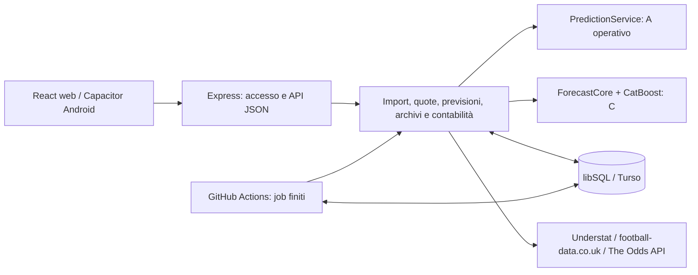

# Architettura di FootPredictor

Questa guida descrive codice e configurazioni del repository. Non certifica quale revisione sia distribuita, quali flag remoti siano abilitati, quale modello sia selezionato nel database o quando sia riuscita l'ultima Nightly. Questi fatti richiedono riscontri dell'ambiente interessato.

## Componenti e responsabilità

FootPredictor è un monolite modulare: React presenta i dati, Node.js/Express/TypeScript coordina servizi e modelli, libSQL/Turso conserva lo stato condiviso. Non ci sono microservizi ML, Redis o un broker di messaggi. Android include il frontend tramite Capacitor e usa le stesse API.

La separazione è logica, nello stesso backend. La Nightly avvia sul runner un'istanza temporanea del backend per la manutenzione e usa gli stessi moduli per confronto e registrazioni virtuali. Python/CatBoost serve al training separato; l'inferenza C valuta alberi JSON nel processo Node.

Fonti: [avvio](../backend/src/index.ts), [API](../backend/src/api/routes.ts), [servizio A](../backend/src/services/PredictionService.ts), [runtime C](../backend/src/research/ResearchRuntime.ts), [CatBoost](../backend/src/research/CatBoostModel.ts).

## App e richieste

La navigazione principale comprende Partite, Giocate e Budget; Archivio e Dati e aggiornamenti sono fra gli strumenti. Backtest, Research e viste interne dei dati restano raggiungibili dalle rispettive route. Research riguarda benchmark e modelli; la contabilità A/C si consulta nelle pagine normali.

Il dettaglio si apre su Analisi sportiva. La prima lettura delle quote usa la cache. Nella scheda Giocate A e C, senza quote sufficientemente recenti, un componente dedicato può richiederle automaticamente al provider con `requestNetwork: true`. Conserva un tentativo per partita per cinque minuti e permette un nuovo tentativo manuale. La richiesta può consumare crediti; aprire una schermata non registra una puntata.

A usa `POST /api/predict/jobs` e `GET /api/predict/jobs/:id`: il calcolo resta quello di `PredictionService`. I job sono temporanei e in memoria; un riavvio può interromperne il recupero. Restano disponibili `/api/predict` e `/api/predict/replay`.

I consigli A/C archiviati hanno precedenza nella presentazione. Senza una decisione C archiviata, `POST /api/research/challenger-preview` può produrre un'anteprima corrente. Il servizio di anteprima usa solo quote in cache: non abilita autonomamente la rete, non registra giocate o prove prospettiche. L'acquisizione della scheda Giocate è un percorso distinto.

Fonti: [navigazione](../frontend/src/App.tsx), [dettaglio](../frontend/src/components/predictions/PredictionWorkbenchView.tsx), [richiesta quote](../frontend/src/components/predictions/MatchQuoteRequest.tsx), [prima lettura](../frontend/src/hooks/useOddsForMatch.ts), [job A](../backend/src/services/PredictionJobService.ts), [anteprima C](../backend/src/research/ChallengerPreviewService.ts).

## Dati, quote e mercati

| Fonte | Ruolo nel codice |
|---|---|
| Understat | Fonte primaria per squadre, partite, risultati, xG e statistiche disponibili |
| football-data.co.uk | Supplemento HTTP/CSV per campi mancanti e quote storiche di chiusura; preserva i valori Understat esistenti |
| football-data.org | Calendario e risultati dell'import alternativo opt-in; mapping revisionato e cache condivisa, senza sostituzione degli xG |
| The Odds API | Unico provider quote del runtime, con bookmaker, selezione, prezzo e timestamp effettivi |
| API-Football | Disponibilità e formazioni opzionali, disabilitate nei default forniti |

FotMob, Transfermarkt, FBref e lo scraper supplementare SofaScore non sono fonti attive di questo flusso. Copertura e freschezza dipendono da campo, competizione e stagione: un importatore implementato non garantisce dati completi.

La [guida delle fonti](data-sources.md) distingue copertura, limiti e diritti delle alternative esaminate. `NIGHTLY_SOURCE_MODE=verified-alternatives` collega collector football-data.org, import transazionale e CSV con cache condivisa alla Nightly. `FixtureAdmission` e `NightlyFixtureReadiness` verificano la singola fixture, stato/orario, identità, input, parametri, calibrazione e campioni per mercato; non richiedono il successo globale Understat. Gli xG originali sono conservati e HxG/AxG CSV restano esclusi. Bootstrap cache, scritture operative e attivazioni richiedono il proprio consenso; il codice locale e il comando di staging non attestano un'esecuzione remota.

Tiri, SOT, gialli e rossi mantengono distinta l'assenza da uno zero osservato lungo acquisizione, aggregazioni, contesto, modelli, calibrazione e replay. Le coperture per campo e sede sono metadata negli attuali JSON squadra/giocatore, senza nuove migrazioni. I modelli usano i prior esistenti con campione zero quando manca evidenza; le soglie di disponibilità si applicano per famiglia prima delle probabilità selezionabili, anche nei payload strutturati API. Le letture arbitrali non sostituiscono medie legacy calcolate su finestre sconosciute. La pagina Dati mostra un trattino per medie mancanti. Vedere il [contratto delle osservazioni](data-observation-contract.md) per provenienza, denominatori, fallback e verifiche; nessun dato storico o profilo persistito viene riparato da queste modifiche del codice.

Il contesto dei tiri giocatore ammette profili con sola identità soltanto con evidenza di titolarità riferita alla partita/squadra e acquisita entro l'as-of. Il filtro agisce sui soli input del modello, preserva il roster e non trasforma un prior in osservazione; riconosce anche l'alias portiere `Goalkeeper`. È una correzione dell'ammissibilità dei dati, senza modifica delle formule o attivazione dei giocatori opzionali.

Il valutatore prospettico locale in modalità strict richiede hash del codice atteso e fonte esiti espliciti. Li controlla dopo la prima previsione e l'ultimo esito selezionati dalle query canoniche; legge inoltre l'ultimo stato della fonte senza filtrarlo in anticipo. Un'origine discordante o un record non ammissibile non autorizza il recupero di una previsione/esito precedente. Questi controlli SELECT-only non attivano il collector, non attestano da soli una preregistrazione indipendente e non risolvono la genealogia temporale mancante. Il contratto è nel [protocollo A](models/MODEL-A-VALIDAZIONE-PROSPETTICA.md).

Il trasporto quote usa un registro persistente condiviso per cache, prenotazioni, lease, costi e budget. Il limite mensile predefinito è 500 crediti; le richieste informative devono preservarne 50 per quelle essenziali. Questi valori non sono il saldo dell'account. Gli header del provider restano il riferimento per i consumi osservati. Non è configurato un secondo provider come fallback.

Sono ammesse quote di più bookmaker, mantenendo quello effettivo per ogni prezzo. Completamenti sintetici o prodotti dal modello restano interni: non sono quote bookmaker, non entrano nel consiglio eseguibile e non dimostrano value, ROI o CLV. Senza prezzo reale il mercato resta indisponibile.

A e la release C corrente condividono il catalogo delle quote reali dei mercati squadra. La composizione C `c-team-markets-v1` usa la propria matrice per i mercati gol e le opportunità qualificate dello specialista A per tiri, tiri in porta e cartellini, conservandone identità ed evidenza. Campioni, calibrazione e quote coerenti restano vincolanti; le policy correnti definiscono i mercati supportati nel codice, senza usare il registro qualitativo per abilitarli. Gli archivi precedenti mantengono il significato delle rispettive policy. Corner e falli restano bloccati per le giocate. Le player props sono separate e richiedono abilitazione, campione e quota reale abbinata senza ambiguità. Per i cartellini totali l'unità è gialli + 2 × rossi. Le guide [A](models/MODEL-A.md) e [C](models/MODEL-C.md) descrivono i rispettivi limiti.

Fonti: [supplemento](../backend/src/services/FootballDataService.ts), [configurazione quote](../backend/src/services/odds-provider/providerRuntimeConfig.ts), [gestore persistente](../backend/src/services/odds-provider/SmartOddsRequestStore.ts), [selezione bookmaker](../backend/src/services/BookmakerOddsSelectionService.ts), [player props](../backend/src/services/playerProps.ts).

## Modelli, registrazioni e contabilità

A operativo è `PredictionService`, identificato come `APP-A-…` con hash di codice, configurazione e stato. C usa gli stessi componenti matematici correnti attraverso `ForecastCore`, che ricostruisce gli input disponibili al forecast. Non conserva una copia eseguibile di A80; questa ricostruzione statistica non replica tutto lo stato operativo di A.

La release C corrente `C-271c9573ba485956` è dichiarata in `CurrentChallengerRelease.ts`, con un solo artefatto in `backend/current-models/challenger.json`. Usa valori delle foglie proiettati con i supporti del training e calibrazione coerente ristimata. L'attivazione esplicita dell'utente è distinta dalla review scientifica: le prove storiche non dimostrano superiorità futura. Registrazione e sostituzione sono controllate da piano, backup, hash e stato del registro; la presenza del file non dimostra uso remoto. Nightly e anteprima richiedono l'identità corrente; vecchi modelli non sono alternative operative o di rollback. Tre fallimenti tecnici indipendenti possono sospendere C. Record e decisioni storici restano immutabili e collegati alle proprie evidenze.

La Nightly automatica e le azioni manuali usano importi in euro nei portafogli virtuali esistenti `shadow_A` e `shadow_C`, con saldi e ledger conservati e separati. Non inviano puntate ai bookmaker.

| Origine | Importo |
|---|---|
| Nightly A | Percentuale dinamica suggerita da A sul patrimonio A a inizio gruppo |
| Nightly C | Percentuale dinamica suggerita dal motore sulle probabilità C, sul patrimonio C a inizio gruppo |
| Manuale A/C | Importo scelto e confermato dall'utente |

La policy `funded-dynamic-stake-v1` verifica quota reale recente, kickoff futuro, identità, probabilità, EV, prudenza e assenza della stessa selezione per famiglia/partita. Considera tutte le selezioni qualificate, senza top N, massimo per partita o tetto cumulativo del 5%. Nella transazione legge il patrimonio iniziale del gruppo (disponibile + impegnato), applica la percentuale suggerita dal modello e finanzia soltanto importi completi coperti dal saldo disponibile. La priorità è HIGH, MEDIUM, LOW, poi EV decrescente e chiave; percentuali mancanti/invalide non ricevono fondi. La migrazione 030 conserva giocate e liquidazioni dinamiche immutabili sul `research_ledger` esistente. La 031 consente cancellazioni immutabili delle precedenti giocate fisse con rimborso esatto dello stake: disponibile aumenta, impegnato diminuisce e patrimonio resta invariato. Le giocate cancellate sono escluse da operatività e settlement, senza riscrivere le loro righe. Anche le azioni manuali verificano il saldo senza tetto cumulativo del 5%. L'archiviazione di proposte senza stake non impegna capitale.

Lo storico del precedente budget è classificato esplicitamente come A deterministico (`model_family = A`, identificatore di vista `legacy_deterministic_A`). Mantiene capitale e provenienza distinti dai portafogli A/C: non si sommano i capitali né si attribuisce allo storico una versione APP-A non documentata.

Le pagine principali leggono saldi, importi e storico da `GET /api/wallets` e `/api/wallets/archive`. Le letture non inizializzano un capitale. Aggregati e liste paginate non vanno confusi. Le azioni manuali usano `POST /api/wallets/bets/manual` e `POST /api/wallets/opportunities/archive/manual`. Il registro paper precedente resta evidenza distinta: le cancellazioni logiche immutabili lo escludono dai totali operativi e dalle liquidazioni, senza conversioni di unità in euro o cancellazioni fisiche.

Il settlement liquida registrazioni esistenti con risultati verificati; `/api/results/refresh` può importare finali e avviare questa manutenzione. `/api/automation/place-valid-bets` è ritirata e risponde 410. Le API del budget precedente restano un percorso distinto.

La liquidazione research richiede entrambi i punteggi come interi finiti non negativi: assenti, stringhe vuote, booleani e valori invalidi lasciano la giocata irrisolta. Zero e stringhe numeriche valide restano osservazioni. Durante la preparazione, un evento quote esplicitamente completato o live, oppure con kickoff illeggibile, viene rifiutato prima di ogni aggiornamento del kickoff. Le correzioni di orario conservano il percorso precedente: anche un anticipo già trascorso può aggiornare il job, che perde la finestra senza puntare retroattivamente. Nessuna formula di pagamento o baseline C cambia.

Fonti: [policy](../backend/src/research/ResearchRecommendationPolicy.ts), [esecuzione](../backend/src/research/ResearchRecommendationRuntime.ts), [store](../backend/src/research/ResearchRecommendationStore.ts), [manuale](../backend/src/services/ManualModelBetService.ts), [archivio](../backend/src/services/WalletArchiveService.ts), [identità storico](../backend/migrations/027_deterministic_bet_model.sql).

## Processi programmati

Il workflow Nightly dichiara 03:07 Europe/Rome e recuperi alle 04:17 e 05:27. La programmazione non garantisce l'istante effettivo di avvio. Guard giornaliero, concorrenza del workflow e lease persistenti limitano le duplicazioni secondo il protocollo; retry dopo errori e recuperi espliciti hanno regole proprie.

Il flusso completo comprende import, supplemento, manutenzione risultati, liquidazioni e, con i flag previsti, nuove decisioni A/C. La Nightly legge soltanto profili di calibrazione A persistiti con chiave esatta: su MISS/errore A si astiene, senza ricalibrazione implicita. La preparazione della cache è un comando operativo separato ed esplicito. Il settlement resta distinto dal consenso a creare nuove giocate. Il web non è un timer di puntata e il vecchio eseguibile T−15 è ritirato.

Training settimanale, preparazione della calibrazione A e watchdog sono workflow separati. Il training può registrare candidature e riesaminare il gate di adozione solo con il relativo flag; le metriche di sviluppo non adottano un modello. Il watchdog distingue controllo GitHub e controllo DB con token di sola lettura. Questi file non attestano che i workflow remoti siano attivi.

La procedura e i flag hanno una sola guida: [Nightly](github-actions-nightly-sync.md). Training, valutazione e registro C sono in [Research](research-platform.md).

## Esecuzione, database e accesso

Compose avvia backend e frontend sulle porte dichiarate 3001 e 3000. Nginx inoltra `/api` al backend del Compose. Non avvia un database separato: il backend usa URL e token libSQL/Turso dell'ambiente. L'avvio normale inizializza lo schema e applica le migrazioni disponibili; avviare l'app non è un audit in sola lettura. Le migrazioni devono preservare dati e payload esistenti.

I comandi root caricano `.env` nel backend con espansione disabilitata. Il client usa `REACT_APP_API_URL` se valorizzato in build; altrimenti il browser usa `/api` e Android l'indirizzo Hostless predefinito nel client. **Il proxy CRA attuale punta a Hostless**, mentre Nginx nel Compose punta al container backend. Non sono configurazioni equivalenti per lo sviluppo locale.

Compose forza `NIGHTLY_ORCHESTRATOR=github_actions` e disabilita scheduler interni e nuove registrazioni automatiche nel processo web. Il caricatore supporta anche l'orchestratore backend per gli import, senza riattivare il placement legacy. Giocatori e formazioni sono opzionali e in pausa nei default forniti.

L'accesso è amministrativo condiviso con identità dati canonica, non un servizio multiutente con portafogli per account. Password verificata tramite hash, sessioni persistenti con hash del token, cookie HttpOnly, origini ammesse e limiti di login proteggono le API. In produzione l'autenticazione non può essere disabilitata dal flag e richiede una password configurata. L'healthcheck essenziale è pubblico; le chiamate interne hanno token dedicato e vincolo loopback. Segreti e credenziali non appartengono al frontend o all'APK.

Fonti: [Compose](../docker-compose.yml), [database](../backend/src/db/DatabaseService.ts), [scheduler](../backend/src/services/NightlySchedulerConfig.ts), [script root](../package.json), [proxy CRA](../frontend/src/setupProxy.js), [Nginx](../frontend/nginx.conf), [client](../frontend/src/utils/api.ts), [accesso](../backend/src/security/SharedAdminAuth.ts).

## Verifica e limiti

`/api/health` prova che il processo HTTP risponde; non certifica provider, dati aggiornati, risultati sportivi, database o riuscita della Nightly. API di stato e record persistenti forniscono riscontri distinti. Cache locali, job in memoria e lock di processo non coordinano tutte le repliche; scritture di altri processi possono apparire dopo la scadenza delle cache.

Le procedure canoniche sono [operazioni](operations/README.md), [hosting](operations/hostless-deployment.md), [backup](operations/turso-backup.md) e [Android](android-private-apk.md). Una build o un test locale non attestano pubblicazione, salute remota, copertura completa o redditività.
