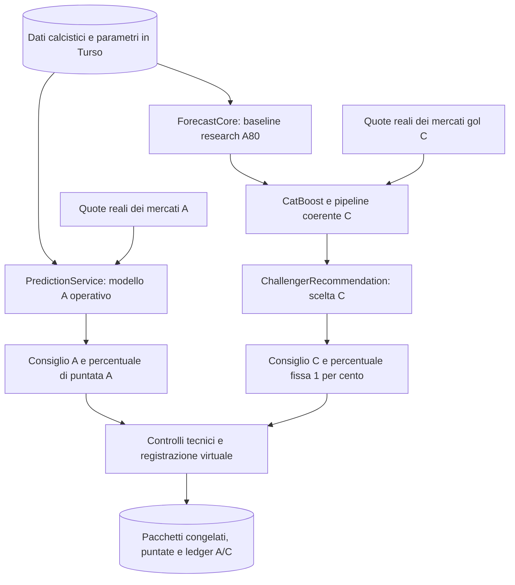

# Architettura e algoritmi dei modelli A e C

Verifica dei sorgenti: 30 ottobre 2026. Queste guide descrivono il percorso
operativo `virtual-recommendation-v2`; i report datati restano prove storiche.
La corrispondenza con il codice non dimostra qualità delle previsioni o profitto.

## Quale documento leggere

| Documento | Contenuto |
|---|---|
| [Architettura generale](../SYSTEM-DESIGN.md) | Frontend, backend, database, fonti, quote, processi e distribuzione |
| [Modello A](MODEL-A.md) | Previsione dell'app, modelli statistici, mercati, scelta della giocata e importo |
| [Modello C](MODEL-C.md) | Baseline, CatBoost, matrice dei gol, calibrazione coerente, selezione e limiti |
| [Formulario A](../FORMULARIO-sistema-scommesse.md) | Formule e configurazioni storiche di A, da leggere con la guida corrente |
| [Esecuzione Nightly](../operations/recommendation-execution-2026-10-30.md) | Registrazione virtuale, controlli, dati congelati e riscontri operativi |
| [Piattaforma research](../research-platform.md) | Benchmark, validazione, evidenze future e promozione dei modelli |

## Due percorsi di previsione, due decisioni

La baseline A80 usata da C è una versione research fissata. Non è il consiglio
del `PredictionService` corrente: le due identità e configurazioni vengono
conservate separatamente. Il diagramma riassume responsabilità logiche;
preparazione diagnostica e registrazione sono fasi distinte dello stesso backend.

| Aspetto | A operativo | C |
|---|---|---|
| Probabilità | `PredictionService`, Dixon-Coles/Poisson-xG e modelli statistici specializzati | Artefatto CatBoost con baseline fissata e distribuzione congiunta dei gol |
| Mercati | Mercati squadra già supportati dall'app, con dati e quote reali | Mercati gol ammessi dal registry C e dalle quote effettivamente disponibili |
| Calibrazione e confronto con le quote | Percorso dell'app | Pipeline coerente C; nessuna seconda calibrazione/blend nel selettore finale |
| Valutazione e scelta | `ValueBettingEngine` e consiglio canonico dell'app | Riusa le funzioni di valutazione e consiglio canonico, con input e probabilità C |
| Importo richiesto | Percentuale originale consigliata da A | 1% secondo la policy C |
| Contabilità | Portafoglio `shadow_A` | Portafoglio `shadow_C` |

L'indipendenza dei percorsi non significa che ogni funzione sia duplicata.
C riusa `ValueBettingEngine` per filtri, valore atteso e confidenza e
`pickCanonicalBetRecommendation` per il ranking finale. Non esiste una
classifica congiunta che scelga una sola giocata tra A e C; i mercati aggiuntivi
di A non vengono assegnati a C.

## Che cosa fa l'automazione

[ResearchRecommendationRuntime](../../backend/src/research/ResearchRecommendationRuntime.ts)
prepara e verifica i due pacchetti; per A chiama il servizio dell'app, per C
consuma la previsione research e costruisce il consiglio C.
[ResearchRecommendationNightly](../../backend/src/research/ResearchRecommendationNightly.ts)
coordina i job e
[ResearchRecommendationStore](../../backend/src/research/ResearchRecommendationStore.ts)
registra decisioni, puntate virtuali e movimenti contabili in modo coerente.

Prima di finanziare una giocata vengono verificati identità del modello,
provenienza e freschezza della quota, kickoff, importo, disponibilità,
esposizione e duplicati. Un consiglio può quindi non diventare una puntata.
La Nightly non crea una terza categoria con un proprio algoritmo di consiglio.
Non invia puntate ai bookmaker.

## Come leggere un'astensione

`NO_BET` nel pacchetto di raccomandazione significa che il selettore non ha
restituito una giocata. `ABSTAIN` nel registro di esecuzione può indicare quel
risultato oppure un controllo tecnico fallito: va letto insieme al pacchetto
e alle esclusioni delle singole quote.

Per C, rimborsi e puntate suddivise non sono attualmente ammessi dal selettore
finale. Inoltre la causale globale
`non_binary_payout_not_supported_by_canonical_engine` viene usata, in assenza
di un consiglio, anche quando soltanto alcune quote sono state escluse per
quel motivo. Non dimostra che esistesse una giocata valida bloccata dalla
Nightly. La [guida C](MODEL-C.md) descrive questo limite diagnostico.

## Verifica e limiti delle guide

I collegamenti indicano le implementazioni proprietarie dei singoli passaggi.
Per verificare la descrizione si confrontano chiamate tra servizi, flag,
configurazioni, formule e pacchetti salvati; per una specifica Nightly si
leggono gli snapshot di quella esecuzione, senza ricostruire il passato con
quote o dati successivi. Questa revisione è documentale: non attiva training,
chiamate provider, nuove puntate, liquidazioni o deploy.
