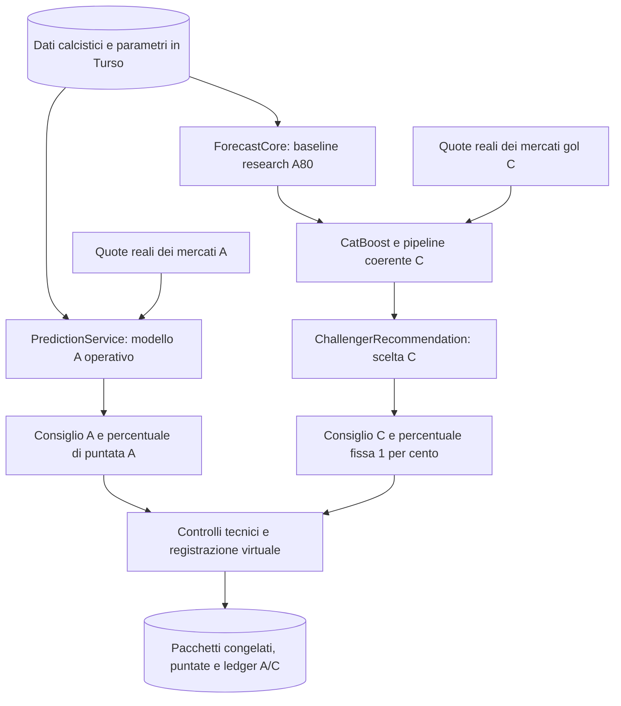

# Architettura e algoritmi dei modelli A e C

Verifica dei sorgenti: 31 ottobre 2026. Il default conserva la policy v2 e
C906 legacy. Il nuovo selettore autonomo C e le feature aggiuntive restano
candidati fino a un'adozione approvata; il deployment adottato ha una propria
identità di esecuzione v3. I report datati restano prove storiche.
La corrispondenza con il codice non dimostra qualità delle previsioni o profitto.

## Quale documento leggere

| Documento | Contenuto |
|---|---|
| [Architettura generale](../SYSTEM-DESIGN.md) | Frontend, backend, database, fonti, quote, processi e distribuzione |
| [Modello A](MODEL-A.md) | Previsione dell'app, modelli statistici, mercati, scelta della giocata e importo |
| [Modello C](MODEL-C.md) | Baseline, CatBoost, matrice dei gol, calibrazione coerente, selezione e limiti |
| [Formulario A](../FORMULARIO-sistema-scommesse.md) | Formule e configurazioni storiche di A, da leggere con la guida corrente |
| [Esecuzione Nightly](../operations/recommendation-execution-2026-10-30.md) | Registrazione virtuale, controlli, dati congelati e riscontri operativi |
| [Piattaforma research](../research-platform.md) | Benchmark, validazione, evidenze future e promozione dei modelli |
| [Miglioramenti C, 31 ottobre](../performance/c-hybrid-improvements-2026-10-31.md) | Piano controllato, artefatti e risultati realmente ottenuti, limiti e decisione di adozione |
| [Audit dati e benchmark C](../performance/c-data-benchmark-audit-2026-10-31.md) | Cinque target post-evento, 22 record isolati, metriche indipendenti e corpus ricostruito da 1.969 test |

## Due percorsi di previsione, due decisioni

La baseline A80 usata da C è una versione research fissata. Non è il consiglio
del `PredictionService` corrente: le due identità e configurazioni vengono
conservate separatamente. Il diagramma riassume responsabilità logiche;
preparazione diagnostica e registrazione sono fasi distinte dello stesso backend.

| Aspetto | A operativo | C |
|---|---|---|
| Probabilità | `PredictionService`, Dixon-Coles/Poisson-xG e modelli statistici specializzati | Artefatto CatBoost con baseline fissata e distribuzione congiunta dei gol |
| Mercati | Mercati squadra già supportati dall'app, con dati e quote reali | Mercati gol ammessi dal registry C e dalle quote effettivamente disponibili |
| Calibrazione e confronto con le quote | Percorso dell'app | Pipeline coerente C; nessuna seconda calibrazione/blend nel selettore finale |
| Valutazione e scelta | `ValueBettingEngine` e consiglio canonico dell'app | Legacy C906: motore value e picker condivisi. Candidato `payout-aware-v1`: selettore autonomo sui ritorni effettivi. |
| Importo richiesto | Percentuale originale consigliata da A | 1% secondo la policy C |
| Contabilità | Portafoglio `shadow_A` | Portafoglio `shadow_C` |

L'indipendenza dei percorsi non significa che ogni funzione sia duplicata.
Il default legacy C906 riusa `ValueBettingEngine` e
`pickCanonicalBetRecommendation`. Il nuovo selettore C non li usa: calcola
EV, rischio e crescita logaritmica dalla distribuzione completa dei ritorni,
inclusi rimborsi e mezzi esiti. Non inventa una confidenza o un'incertezza
parametrica quando manca l'evidenza. L'adozione non è implicita. Non esiste una
classifica congiunta che scelga una sola giocata tra A e C; i mercati aggiuntivi
di A non vengono assegnati a C.

## Che cosa fa l'automazione

[ResearchRecommendationRuntime](../../backend/src/research/ResearchRecommendationRuntime.ts)
prepara e verifica i due pacchetti; per A chiama il servizio dell'app, per C
consuma la previsione research e costruisce il consiglio C.
[ResearchRecommendationNightly](../../backend/src/research/ResearchRecommendationNightly.ts)
coordina i job e
[ResearchRecommendationStore](../../backend/src/research/ResearchRecommendationStore.ts)
registra decisioni, puntate virtuali e movimenti contabili in modo coerente.

Prima di finanziare una giocata vengono verificati identità del modello,
provenienza e freschezza della quota, kickoff, importo, disponibilità,
esposizione e duplicati. Un consiglio può quindi non diventare una puntata.
La Nightly non crea una terza categoria con un proprio algoritmo di consiglio.
Non invia puntate ai bookmaker.

## Come leggere un'astensione

`NO_BET` nel pacchetto di raccomandazione significa che il selettore non ha
restituito una giocata. `ABSTAIN` nel registro di esecuzione può indicare quel
risultato oppure un controllo tecnico fallito: va letto insieme al pacchetto
e alle esclusioni delle singole quote.

Per C906 legacy, rimborsi e puntate suddivise non sono ammessi dal selettore
finale. Inoltre la causale globale legacy
`non_binary_payout_not_supported_by_canonical_engine` viene usata, in assenza
di un consiglio, anche quando soltanto alcune quote sono state escluse per
quel motivo. Non dimostra che esistesse una giocata valida bloccata dalla
Nightly. Il candidato autonomo gestisce invece i payout non binari ed espone
esclusioni e motivi precisi nel pacchetto, senza riscrivere lo storico.
La [guida C](MODEL-C.md) descrive entrambi i percorsi.

## Come viene valutata una modifica C

Le nuove feature sono versionate in due blocchi: xG recenti corretti per
avversario e calendario osservato. I confronti usano l'ora Nightly effettiva
quando registrata, altrimenti una boundary nominale `Europe/Rome` esplicita,
gestendo i cambi d'ora. Non si rinomina un dataset T−15 come Nightly.

Il trainer controllato distingue sei bracci fissi e quattro intervalli
cronologici per fold: training, selezione, calibrazione e test. Le 745
partite finali già esposte non rientrano nei target di ottimizzazione né nelle
feature aggiuntive. La baseline legacy può continuare a usare normale
storia as-of ammissibile senza modificarne la matematica.

Una candidate congelata deve poi superare il gate preregistrato sulle prime
500 previsioni `FUTURE_TEST`, conservate prima dei risultati e valutate una
sola volta contro l'incumbent C. Il registro consente adozione e rollback
documentati, non una promozione ottenuta ripetendo lo stesso test. Lo schema
è introdotto dalla migrazione additiva 025. L'evidenza attuale non basta a
sostituire C906: codice candidato e risultati offline non sono adozione.

Parametri incerti, disponibilità storica delle fonti e assenza di quote reali
all'ora Nightly restano limiti espliciti. Le metriche probabilistiche non
dimostrano ROI, profitto bookmaker o superiorità rispetto all'intero APP-A.

## Verifica e limiti delle guide

I collegamenti indicano le implementazioni proprietarie dei singoli passaggi.
Per verificare la descrizione si confrontano chiamate tra servizi, flag,
configurazioni, formule e pacchetti salvati; per una specifica Nightly si
leggono gli snapshot di quella esecuzione, senza ricostruire il passato con
quote o dati successivi. Questa revisione è documentale: non attiva training,
chiamate provider, nuove puntate, liquidazioni o deploy.
