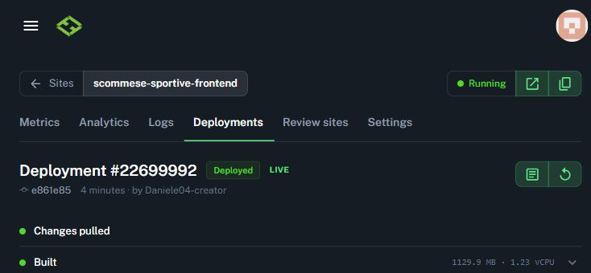

# Consigli A/C nel dettaglio partita — 31 ottobre 2026

Aprire una partita mostra due schede separate, Modello A e Modello C. Il frontend
legge `GET /api/research/forecasts?matchId=…` usando la sessione autenticata esistente.
L'endpoint restituisce le decisioni effettive dopo recuperi e cancellazioni. La
schermata non registra puntate, modifica saldi o chiama provider per ottenere C.
L'analisi A preesistente continua a funzionare come prima.

## Origine e significato

- Solo le righe `authority=execution` rappresentano questi consigli operativi.
  A80 e le altre righe research `legacy` non sono il metodo A dell'app.
- Una decisione archiviata prevale sull'analisi aperta successivamente. Prezzo e importo
  provengono dall'archivio: l'importo non viene ricalcolato usando il saldo corrente.
  Il planner dello stake attuale rimane nascosto quando è disponibile la decisione A
  archiviata, anche se la risposta dell'analisi A non contiene ancora tale proiezione.
- Se A non ha un archivio valido, viene mantenuta la scheda A esistente, con origine
  esplicita: analisi attuale o replay retrospettivo. I calcoli A non vengono modificati.
- C usa soltanto il suo pacchetto Nightly archiviato. Se manca, compare “Consiglio non
  ancora disponibile”: non equivale a un consiglio di non puntare. Non esiste una nuova
  inferenza C eseguita aprendo questa pagina.
- Un pacchetto valido senza selezione rappresenta nessuna giocata consigliata.
  Un errore tecnico rappresenta invece una valutazione non utilizzabile.
- Un consiglio positivo bloccato da esposizione, capitale o unicità della puntata
  rimane visibile come consiglio del motore, con importo registrato zero e motivo del blocco.
  Pacchetti positivi rimasti dopo errori tecnici non vengono presentati come consigli validi.
- La quota viene mostrata solo se selezione, prezzo, bookmaker e provenienza corrispondono
  ai dati conservati; quote sintetiche o incoerenti restano non disponibili.
- `SETTLED` significa liquidata: questa API non espone il verdetto vinta/persa e la
  schermata non lo deduce dal solo stato.

Le schede si impilano su telefono. Il caricamento dell'archivio è indipendente
dall'analisi A: un errore o ritardo di A non nasconde C. Cambiare partita annulla la
richiesta precedente e impedisce che una risposta tardiva riappaia sul nuovo incontro.
“Aggiorna” rilegge anche l'archivio; gli errori rimangono visibili e hanno un comando di ritento.

## Verifica ripetibile

```powershell
cd frontend
$env:CI='true'
npm run test:ci -- --runInBand
npm run typecheck
npm run lint
npm run build
```

Regressioni backend di A, senza modificarne sorgenti o fixture:

```powershell
cd backend
npm run build
node --test test/operational-a-regression.test.js
git diff 22903c83 --exit-code -- backend
```

I test frontend coprono consigli diversi, fonte A corretta, dati mancanti, errori,
quote incoerenti, blocchi contabili e cambi di partita. I test di pagina verificano
anche C disponibile mentre A è in attesa o fallisce e ricaricamento senza mutazioni.
Le prove browser con fixture controllano il flusso e il layout; non dimostrano
una nuova acquisizione bookmaker o il login su un telefono fisico.

## Esito finale

Fonte applicativa `e861e85a74f45c9aad1d6f8a2a74956eb9fd92c2`: 258 test frontend
passati, typecheck/lint/build riusciti, 7 regressioni A passate e backend invariato.
La [CI del commit](https://github.com/Ivandragon003/scommeseSportive/actions/runs/41215362436)
è riuscita per Backend e Frontend. I test backend sono 1.186: 1.185 passati,
nessun fallimento, un test saltato.

Undici scenari browser passati, con 88 richieste API intercettate da fixture e
nessun provider o movimento contabile reale. La revisione indipendente ha trovato
un caso di origine errata dopo refresh fallito: è stato corretto, coperto da un
test di pagina e riprovato nel browser. La revisione successiva non ha trovato
altri problemi P1/P2.

La [1.1.5 Android](../android/releases/1.1.5-2026-10-31.md) include la stessa UI;
firma, aggiornamento, due test strumentali e avvio della WebView sono verificati.
Telefono fisico e login autenticato restano non verificati.

Il [riepilogo delle evidenze](evidence/match-model-advice-2026-10-31.json) collega
commit, APK, bundle browser, test e verifiche native, distinguendo fixture da produzione.

## Pubblicazione web

Il frontend è **LIVE** dal commit `e861e85a74f45c9aad1d6f8a2a74956eb9fd92c2`,
[deployment Hostless `6ae60aa058c3b12e22699992`](https://hostless.cloud/sites/scommese-sportive-frontend/deployments/6ae60aa058c3b12e22699992).
Il backend non è stato ridistribuito o riconfigurato.

Manifest e asset pubblici rispondono HTTP 200. Il bundle cloud
`main.eec012ef.js` ha SHA-256
`f4fe056eb14c6a25274696ee62cbad7ded80989ed091b150bc7385011dfb68c8`.
La build web cloud e quella inclusa nell'APK hanno bundle differenti: non viene
dichiarata identità binaria. La source map pubblica del cloud conferma invece la
corrispondenza dei tre sorgenti della feature, normalizzando i fine riga:
`MatchModelAdvice.tsx`, `matchModelAdviceApi.ts` e `PredictionWorkbenchView.tsx`.
Il dettaglio autenticato in produzione non è stato aperto con credenziali reali.


