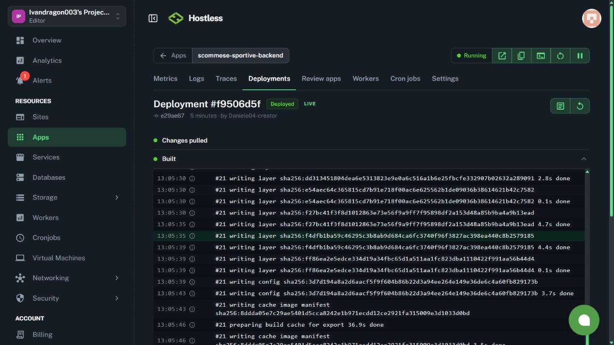

# Nightly: quote e recupero tecnico — 31 ottobre 2026

**Stato finale: 18/18 partite rivalutate, quattro nuove puntate e otto puntate
virtuali complessive nella giornata.** Nightly, watchdog e CI sono riusciti.
Il fix C è pubblicato e il backend web è `Deployed LIVE` sul commit `e29ae676`.
Tutte le operazioni descritte riguardano portafogli virtuali.

## Diagnosi verificata

Le email di errore riguardano la [Nightly primaria `41184228627`](https://github.com/Ivandragon003/scommeseSportive/actions/runs/41184228627),
il [tentativo `41189187732`](https://github.com/Ivandragon003/scommeseSportive/actions/runs/41189187732)
e il [run successivo `41192970968`](https://github.com/Ivandragon003/scommeseSportive/actions/runs/41192970968).
Anche le segnalazioni dei watchdog corrispondono a problemi effettivi.

Le letture in produzione hanno trovato 22 partite e 44 decisioni finali
nella giornata: quattro puntate finanziate, 36 astensioni tecniche sulle
18 partite e quattro altre astensioni già registrate. In tutte le 18 coppie
A/C il motivo è `odds_credit_budget_exhausted`. I relativi vecchi job di
esecuzione risultano `COMPLETED`: ripetere la normale Nightly li considera
già elaborati e non recupera quelle quote.

L'ultimo run riporta due partite analizzate, zero nuove puntate e 20 partite
già registrate. Questo contatore del singolo run non annulla le quattro
puntate presenti nell'archivio della giornata.

Policy sorgente:
`9a7a37f15c51ed819b74dba7faae90bf51d77c02c9ad1614023ba12d40ebbe33`.

Le quattro puntate già finanziate sono state registrate alle 09:40 UTC
(10:40 a Roma). Tutte hanno kickoff alle 14:30 UTC, cioè 15:30 a Roma.

| Modello | Partita | Mercato | Quota | Stake virtuale |
| --- | --- | --- | ---: | ---: |
| A | Augsburg–Freiburg | Over 3,5 gol | 2,25 | 22,03 euro |
| A | Leverkusen–Stuttgart | Over 3,5 gol | 1,85 | 20,42 euro |
| C | Werder–Hoffenheim | Under 2,5 gol | 3,00 | 10,14 euro |
| C | Leverkusen–Stuttgart | Under 2,5 gol | 3,51 | 10,14 euro |

La chiamata opzionale `/predictions/settle-completed` ha restituito HTTP 400
con `fetch failed`: è un avviso del percorso di archivio. Le liquidazioni
wallet e research hanno risposto HTTP 200. Quell'avviso non dimostra una
perdita di fondi o l'assenza delle quattro puntate.
Nel recupero `41197494187` lo stesso endpoint è riuscito: 25 partite controllate,
zero liquidazioni e 2.600 pronostici non liquidabili in quel lotto. Il precedente
errore di trasporto non si è riprodotto; ciò non certifica la liquidabilità
dell'intero archivio legacy.

## Primo recupero e secondo problema verificato

Il [recupero `41197494187`](https://github.com/Ivandragon003/scommeseSportive/actions/runs/41197494187)
ha usato il commit `d75718724c4a31b24d729c780f465ec646cd8c9e`. La fase virtuale,
dalle 11:44:58 alle 11:48:33 UTC, ha prodotto 15 input e 30 decisioni, con quattro
nuove puntate e tre errori di preparazione. Il workflow è correttamente fallito:
non è una prova di recupero completo. Nessun errore del provider quote è stato
rilevato; restavano 261 crediti su 500.

| Modello | Nuova puntata virtuale | Quota reale | Bookmaker | Stake |
| --- | --- | ---: | --- | ---: |
| A | Troyes–Le Mans, Over 4,5 gol | 7,30 | Coolbet | 4,12 euro |
| C | Troyes–Le Mans, vittoria ospite | 3,30 | Codere | 10,14 euro |
| C | Tottenham–Crystal Palace, vittoria ospite | 4,80 | Codere | 10,14 euro |
| C | Barcelona–Alaves, Under 2,5 gol | 4,63 | Betsson | 10,14 euro |

L'audit SELECT dopo il run verifica che le righe della copia iniziale restano identiche,
comprese le 258 puntate legacy. Le quattro nuove puntate corrispondono al proprio
pacchetto motore, decisione di esecuzione e movimento STAKE; le quote salvate sono
autentiche, fresche e precedenti al kickoff. L'esposizione ricostruita dal ledger
è 4,6288% per A e 4,9975% per C. Le altre raccomandazioni possono quindi essere
escluse dal limite del 5%, anche quando un motore esprime un consiglio.

Le tre partite in errore hanno eventi reali nella cache autenticata del provider,
con kickoff esatto. Il confronto riproducibile offline ha isolato gli alias:

| Partita Understat | Nomi provider | Punteggio squadre precedente | Dopo alias locali C |
| --- | --- | ---: | ---: |
| Borussia M.Gladbach–Paderborn | Borussia Monchengladbach–SC Paderborn | 1,1933 | 2 |
| Hull–Ipswich | Hull City–Ipswich Town | 1,72 | 2 |
| Schalke 04–RasenBallsport Leipzig | FC Schalke 04–RB Leipzig | 1,50 | 2 |

La soglia resta 1,8: non viene abbassata. Restano i controlli di ambiguità,
inversione casa/trasferta e distanza temporale. Il matcher restituisce l'evento
originale, senza riscrivere identificativi, bookmaker, quote o timestamp. Gli
alias sono applicati solo da `ResearchRuntime`; il matcher condiviso con A è
invariato. I test riproducono i tre nomi effettivamente osservati nella cache,
acquisita alle 11:45:38 UTC per EPL e 11:46:21 UTC per Bundesliga.

Un secondo difetto nel wrapper trattava lo stato C `unknown` come cambio di
partita, bloccando A prima della previsione. Ora C indisponibile con kickoff
invariato lascia proseguire A con il proprio loader e pacchetto. I dati C
indisponibili sono scartati. Kickoff cambiato, partita iniziata, conclusa,
rinviata o cancellata restano bloccanti. Il test confronta l'intero risultato
con il caso di errore C già gestito e verifica l'identità del pacchetto A.
L'[evidenza degli alias](evidence/nightly-provider-aliases-2026-10-31.json) contiene
orari, nomi, identificativi e impronte delle cache, senza quote inventate o chiavi.

Il secondo piano in sola lettura ammette esattamente `understat_31262`,
`understat_32304` e `understat_32307`: 3 fonti, 6 decisioni originali, 19 esclusioni.
Le 15 rivalutazioni concluse, incluse le astensioni, vengono preservate.
La nuova policy è `11191adec7c12b440767dc4acadf7f31f9df96239c29eb9c51b55cbfbdb68013`.

## Esito finale verificato

Il [secondo recupero `41199219872`](https://github.com/Ivandragon003/scommeseSportive/actions/runs/41199219872),
sul commit `e29ae676945c113fcb9e226cf61a205dea2fa60a`, è riuscito dopo tutti i gate
dati e la conferma esplicita di esecuzione A/C abilitata. La fase virtuale va
dalle 12:10:42 alle 12:11:34 UTC: tre input, sei decisioni, zero errori, zero
partite iniziate e nessuna nuova puntata finanziata.

Le sei astensioni sono distinte per motore:

- **A, tre casi:** `real_fresh_quotes_unavailable`. Il percorso quote operativo
  conserva i propri controlli e restituisce quote non ammissibili per queste
  tre partite. I punteggi del matcher condiviso restano inferiori a 1,8; gli
  alias aggiunti sono esclusivi del percorso research C. Questo limite A
  resta aperto nel rispetto del vincolo di non modificarne il comportamento.
- **C, tre casi:** `virtual_exposure_limit`. C ha un consiglio, ma i cinque
  stake già aperti impegnano quasi tutto il limite del 5%. Non è un'assenza
  di consiglio del modello e non giustifica aumentare l'esposizione.

L'audit indipendente SELECT delle 12:12:10 UTC è **PASS**: 18 partite logiche,
18 input e 36 decisioni tra i due recuperi, con un solo completamento per fonte.
Le 36 decisioni comprendono quattro BET e 32 ABSTAIN. I tentativi sono 21:
il primo run conserva 15 completamenti e tre ERROR; il secondo aggiunge i tre
completamenti mancanti. Il run fallito e i suoi errori non sono stati riscritti
come successi.

Sono preservate le righe della copia iniziale e quelle del primo recupero,
comprese le quattro puntate nuove, i loro quattro STAKE e le 258 puntate legacy.
Non risultano duplicati per portafoglio/partita, movimenti mancanti o differenze
nelle righe protette. Il budget del nuovo account cambia legittimamente con le
richieste; quello precedente resta a 498 crediti usati e due residui.

| Portafoglio virtuale | Puntate aperte | Disponibile | Impegnato | Equity | Esposizione |
| --- | ---: | ---: | ---: | ---: | ---: |
| A operativo | 3 | 959,53 euro | 46,57 euro | 1.006,10 euro | 4,6288% |
| C906 | 5 | 963,80 euro | 50,70 euro | 1.014,50 euro | 4,9975% |

Le otto puntate sono le quattro precedenti e le quattro della tabella del primo
recupero: 97,27 euro virtuali impegnati in totale. Il secondo run non le modifica.
Le quote delle nuove puntate avevano un'età massima di 198.405 ms al finanziamento,
inferiore al limite di 300.000 ms, e tutti i relativi orari precedono il kickoff.

Il piano SELECT successivo trova **zero fonti ammissibili**, con 22 esclusioni:
15 recuperi già preservati, sei partite con puntate esistenti e una scelta
sportiva già definitiva. È una verifica reale contro il recupero ripetuto,
senza avviare un altro workflow o consumare quote.

Il [watchdog `41200024289`](https://github.com/Ivandragon003/scommeseSportive/actions/runs/41200024289)
è riuscito sia sul controllo GitHub sia sul controllo del database con token
dedicato in sola lettura: `issues: []`, contabilità stabile, zero errori e zero
liquidazioni research arretrate. L'audit manuale separato ha usato il token
disponibile localmente con un wrapper che ammette soltanto SELECT; non viene
presentato come un token limitato dal server.

Questo intervento verifica esecuzione, matching e contabilità. Non misura un
miglioramento predittivo o economico del modello C e non sostituisce una
validazione futura indipendente.

## Crediti e configurazione

I probe di `/sports` non hanno consumato crediti; gli header hanno rilevato:

| Account | Rilevazione UTC del 31 ottobre | Usati | Residui | Costo probe |
| --- | --- | ---: | ---: | ---: |
| Precedente | 11:09:31 | 498 | 2 | 0 |
| Personale già attivo, fornito dall'utente | 11:19:31 | 0 | 500 | 0 |
| Stesso account, probe nel nuovo container web | 11:48:36 | 239 | 261 | 0 |
| Stesso account, probe finale indipendente | 12:14:36 | 282 | 218 | 0 |

L'utente ha verificato il secondo account nella dashboard ufficiale. La
chiave è stata configurata nel file locale `.env` e nel secret GitHub
`ODDS_API_KEY`, senza pubblicarla. Lo scope
`ODDS_API_ACCOUNT_SCOPE`, con etichetta `daniele-oddsapi-20261031`, identifica il relativo
budget. Il supporto nel codice esisteva già; il workflow ora passa esplicitamente
la variabile. Sono stati verificati sia il budget nuovo sia quello precedente.

Il backend Hostless ha un ambiente separato. Anche lì sono stati salvati la
chiave write-only e lo stesso scope, conservando le altre 56 variabili. Il
[deploy `6ae5d3f37716538af9500249`](https://hostless.cloud/apps/scommese-sportive-backend/deployments/6ae5d3f37716538af9500249)
è `Deployed LIVE` sul commit `d757187`. Nel container in esecuzione,
`node scripts/probe-odds-quota.js` ha risposto HTTP 200 con costo 0; `printenv
ODDS_API_ACCOUNT_SCOPE` conferma lo scope atteso. Il solo health HTTP 200 non
viene usato come prova della chiave. Anche il follow-up degli alias è ora
[Deployed LIVE (`6ae5d8ed7716538af9506d5f`)](https://hostless.cloud/apps/scommese-sportive-backend/deployments/6ae5d8ed7716538af9506d5f),
sul commit `e29ae676`, con health HTTP 200 dopo l'avvio.



Il registro finale riconcilia 33 richieste gestite, 282 crediti addebitati e
zero prenotazioni aperte. Il secondo recupero aggiunge cinque richieste e 43
crediti rispetto al primo: il numero di partite non equivale al costo API.

Il precedente budget e le osservazioni storiche restano integri. Il nuovo
scope separa contatori di account reali: non azzera artificialmente la quota
del precedente account.

La [FAQ ufficiale](https://the-odds-api.com/manage/faqs.html) indica il reset
mensile il primo giorno del mese; la dashboard specifica 00:00 UTC. Cambiare
chiave nello stesso account non ricarica i crediti. Non sono stati aggiunti
provider a pagamento né una procedura che crea automaticamente nuovi
account gratuiti quando il budget termina.

## Correzione e limiti del recupero

La prima correzione pubblicata lascia in `ERROR`, con causa e conteggio degli
errori, i nuovi job in cui entrambi i motori si astengono soltanto per un
blocco tecnico delle quote, prima di congelare input e decisioni di
esecuzione definitivi. Le astensioni sportive restano decisioni valide.

Per i vecchi job già conclusi, il piano aggiunge una policy di recupero
collegata alla sorgente e conserva input, decisioni, puntate e movimenti
precedenti. Il piano iniziale riguarda soltanto le 18 coppie tecniche ed
esclude le altre quattro partite, preservando ogni puntata e scelta sportiva
esistente. Il comando `recover-recommendation-technical.js plan` effettua
letture SELECT limitate, verifica le identità e salva un nuovo JSON con
impronta, senza registrare policy o puntate nel database.

La protezione contro recuperi ripetuti controlla tutti i figli della stessa
fonte, anche quando cambia il gruppo di partite. Un recupero concluso,
saltato, con input salvato o con lease ancora attiva impedisce un nuovo
tentativo sulla medesima fonte. Un errore senza input, o una lease scaduta
senza input, può essere riprovato. Collector, helper e controllo atomico nel registro hanno superato insieme i test mirati; la revisione finale ha verificato anche il conflitto fra pianificazione e commit.

Il recupero ricalcola i consigli dei due motori con quote vere e
fresche, prima del kickoff e con i limiti di capitale ed esposizione attivi.
A mantiene il proprio stake; C conserva l'1% e l'esposizione massima resta
il 5% per portafoglio. Nessuna previsione viene retrodatata e nessuna partita
già iniziata può essere recuperata. Anche una rivalutazione riuscita può
produrre un'astensione per scelta sportiva, quote indisponibili o capitale.

A conserva il proprio motore e i mercati supportati; C906 rimane il modello
C attivo, senza adozione di candidati. Non vengono inviate giocate reali ai
bookmaker. Riferimento: [esecuzione dei consigli A/C](recommendation-execution-2026-10-30.md).

## Evidenze e controlli conclusi

È stata conservata una copia privata mirata di 22 job, 22 input, 44 decisioni,
10 puntate complessive, sei liquidazioni, 18 movimenti, due policy e 258
giocate legacy. È una copia delle righe interessate, non un backup completo
del database.
Gli snapshot e lo script SELECT dell'audit sono conservati localmente in
`backend/artifacts/operations/nightly-recovery-20261031/`, escluso da Git.
L'[evidenza pubblica](evidence/nightly-technical-recovery-2026-10-31.json)
riporta conteggi, impronte, preservazione, movimenti e limiti senza segreti o
snapshot integrali.

Dopo il follow-up sono riusciti **158 test Node mirati**, build, typecheck e lint backend. I **63 sorgenti A e condivisi, insieme ai cinque file di fixture e regressione**, restano invariati rispetto a `e16c9714eec0684bcbd964f4e8f41a3b4e29567e`; passano le sette regressioni A. Il recupero è disattivato per default. La revisione finale non rileva P1/P2. La [CI finale `41199077004`](https://github.com/Ivandragon003/scommeseSportive/actions/runs/41199077004) verifica il commit `e29ae676`: backend **1.185 pass, zero errori, un test saltato** su 1.186; frontend lint, typecheck e build riusciti. Il primo intervento aveva già superato 143 test mirati e la [CI `41197376086`](https://github.com/Ivandragon003/scommeseSportive/actions/runs/41197376086).

| Verifica finale | Stato di questo rapporto |
| --- | --- |
| Test e revisione del follow-up | 158 test mirati, build, typecheck e lint PASS; CI completa verde |
| Prima esecuzione reale | `41197494187`: parziale, 15/18, quattro nuove puntate, tre errori |
| Seconda esecuzione sulle sole tre fonti rimaste | `41199219872`: riuscita, 3/3, sei astensioni motivate |
| Copertura aggregata e conservazione dei due snapshot | PASS: 18/18, 36 decisioni, quattro nuove puntate, nessun duplicato |
| Saldi e impronte delle righe protette | PASS; esposizione A 4,6288%, C 4,9975% |
| Watchdog indipendente | `41200024289`: GitHub e database PASS |
| Piano di recupero ripetuto, solo SELECT | Zero fonti ammissibili; 22 esclusioni |

Il recupero è completo nei confini definiti: tutte le 18 fonti hanno una nuova
decisione di esecuzione tracciata. Questo non significa finanziare 18 puntate: rimangono i
controlli dei rispettivi motori, delle quote e dell'esposizione.

## Verifiche ripetibili e limiti

Dal repository, la build e i controlli mirati si ripetono con:

```powershell
cd backend
npm run build
node --test test/operational-a-regression.test.js test/research-event-matching.test.js test/research-recommendation-runtime.test.js
```

Il piano di controllo usa solo SELECT e richiede una configurazione locale
autorizzata. Il percorso di output deve essere nuovo: il comando rifiuta di
sovrascrivere un piano esistente.

```powershell
node --env-file=../.env scripts/recover-recommendation-technical.js plan --source-policy 9a7a37f15c51ed819b74dba7faae90bf51d77c02c9ad1614023ba12d40ebbe33 --day 2026-10-31 --out artifacts/operations/recovery-verification-new.json
```

L'audit confronta quote e timestamp persistiti dal provider con i vettori
congelati del rispettivo motore; non interroga direttamente il bookmaker.
Non ricostruisce indipendentemente il `decisions_hash` preparato a partire dai
risultati successivi all'ammissione: ne verifica conservazione e formato.
La doppia lettura SELECT rileva cambiamenti osservati, senza acquisire un lock
globale. La prova di conservazione copre le righe della copia mirata iniziale,
non tutte le righe storiche del database; quelle fuori baseline non sono
automaticamente nuove righe del recupero.

In locale entrambe le immagini Docker sono state costruite e il backend si è
avviato con health HTTP 200. L'avvio del frontend sulla porta 3000 è stato
bloccato da un'istanza FootPredictor preesistente. Il backend temporaneo è stato
fermato dopo la prova; l'istanza preesistente è rimasta attiva. La build frontend
della CI è riuscita. Non viene dichiarato riuscito il comando Compose completo.

La prima rivalutazione ha consumato 239 dei 500 crediti mensili: una chiave free
non garantisce la copertura di tutte le Nightly con il catalogo completo di A.
Il sistema mantiene budget e segnalazioni di esaurimento. Il rinnovo mensile
è del provider e conserva la stessa chiave; generarne un'altra nello stesso
account non crea nuovi crediti.
