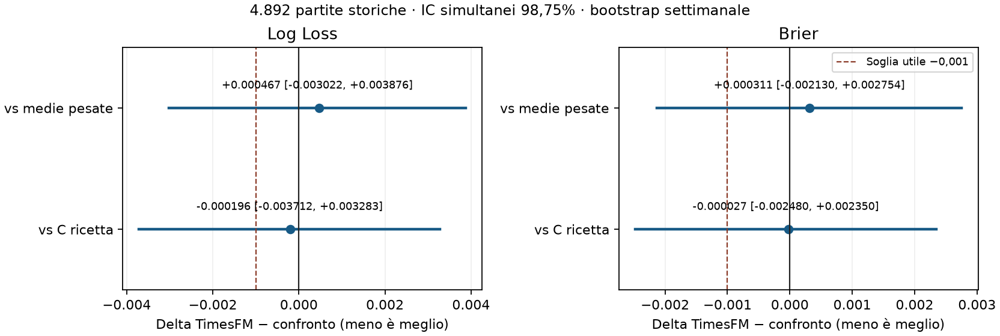

# TimesFM 2.5 per il modello ibrido C — esperimento del 3 novembre 2026

**Verdetto: nessun vantaggio statisticamente dimostrato, esito inconclusivo. NO-GO.** Nessuna integrazione e nessuna candidatura operativa. Non sarebbe corretto convertire l'assenza di significatività in una prova di equivalenza: i dati non consentono una classificazione inferenziale certa tra migliore, equivalente e peggiore.

Nel punto stimato TimesFM ha Log Loss 0.980892, contro 0.981089 della ricetta C invariata e 0.980425 delle medie pesate. Il lieve miglioramento su C e il peggioramento rispetto alle medie non sono robusti. ECE è inferiore, ma da sola non soddisfa il criterio congiunto di beneficio.

**A operativo e C operativo restano invariati.** Il confronto è stato realmente eseguito in locale, su CPU, senza API a pagamento, accessi al database, deploy, registrazioni, puntate o aggiornamenti dei pacchetti produttivi.

## Cosa viene confrontato

C906 autentico è stato creato nel 2026, dopo le stagioni analizzate: il confronto storico rigoroso con quell'artefatto congelato ha **N=0**. Non si retrodata il modello e non si riusa la sua calibrazione futura. Il controllo riproduce invece esattamente la ricetta C906, riaddestrata cronologicamente in ciascun semestre. È un controllo diagnostico, distinto da C operativo e dalla precedente replica depth 3.

| Braccio | Feature | Ricetta restante |
|---|---|---|
| C, ricetta invariata | 40 legacy già esistenti | C906, rifit per semestre |
| C + medie pesate | Stesse 40 + xG/xGA previsti per casa e trasferta | Identica al controllo |
| C + TimesFM | Stesse 40 + gli stessi quattro valori previsti da TimesFM | Identica al controllo |

Due regressori CatBoost Poisson, versione 1.2.8, 120 alberi, profondità 5, learning rate 0,05, seed 20261027, due thread. Miscela 25% baseline research A80 e 75% ML, temperatura 0,8. La calibrazione coerente isotonica 1X2 viene ristimata esclusivamente sulla finestra di calibrazione del fold. Nessuna ricerca di iperparametri: la finestra di selezione rimane separata e inutilizzata. A80 research non è A operativo.

## Dati e separazione temporale

Si riusano i [dati e il piano già pubblicati](c-three-season-backtest-2026-10-31.md): 6.573 righe pulite, storia iniziale 2022/23 e **4.892 stessi target** 2023/24–2025/26. Sono già stati consultati: questa resta evidenza retrospettiva di sviluppo, non un nuovo test indipendente. I 745 ID protetti restano esclusi da tutti i target e dalla storia delle nuove feature. I 22 ID in quarantena restano esclusi da target e storia; la baseline canonica era già stata ricostruita dopo la loro esclusione.

| Fold | Training | Selezione | Calibrazione | Test |
|---|---:|---:|---:|---:|
| 2023/24 luglio–dicembre | 1003 | 410 | 258 | 849 |
| 2023/24 gennaio–giugno | 1793 | 354 | 373 | 898 |
| 2024/25 luglio–dicembre | 2859 | 381 | 178 | 816 |
| 2024/25 gennaio–giugno | 3543 | 327 | 364 | 933 |
| 2025/26 luglio–dicembre | 4615 | 368 | 184 | 801 |
| 2025/26 gennaio–giugno | 5293 | 317 | 358 | 595 |

Finestre e ID sono quelli del piano congelato: training espandente, due mesi di selezione, due di calibrazione, poi test semestrale. Le etichette precedenti devono essere disponibili prima dell'inizio della fase seguente. I test dei sei fold sono disgiunti; un risultato può entrare nei fold successivi dopo la sua disponibilità. Il forecast è l'ultimo confine nominale 03:07 Europe/Rome prima del kickoff, con ora legale.

Per ciascuna squadra e competizione, le nuove serie contengono soltanto xG e xGA Understat effettivamente presenti e disponibili strettamente prima del forecast. Si applica `max(kickoff + 2 ore, availableAt noto)`. Non si riempiono xG mancanti con i gol. La scala temporale è l'indice delle gare osservabili, attraversa le stagioni e non inventa giorni o partite: pause e copertura incompleta possono ridurne l'informazione.

Contesto massimo 64 gare, minimo cinque, orizzonte una gara; le medie esponenziali hanno emivita di cinque gare sugli identici contesti. Per serie più corte, entrambi i bracci usano lo stesso valore legacy già disponibile. Tale fallback e le 40 feature mantengono la semantica della baseline A80, che può includere vecchie partite protette come passato disponibile: le esclusioni aggiuntive non sono una riscrittura di A80. Limiti comuni [0; 8] sulle quattro feature. Nessun aggiustamento scelto dai risultati.

## Risultati sulle identiche 4.892 partite

| Modello | Log Loss ↓ | Brier ↓ | ECE ↓ | Accuracy ↑ |
|---|---:|---:|---:|---:|
| C, ricetta invariata riaddestrata | 0.981089 | 0.584577 | 0.007628 | 53.148% |
| C + medie pesate | 0.980425 | 0.584239 | 0.008605 | 52.984% |
| C + TimesFM 2.5 | 0.980892 | 0.584550 | 0.006331 | 53.066% |

Log Loss usa il logaritmo naturale; Brier è la somma multiclasse, senza dividere per tre. ECE è top-label in dieci intervalli di ampiezza 0,1; accuracy è la frequenza dell'esito 1X2 più probabile. Sono le probabilità dopo calibrazione. Mancano quote Nightly autentiche ammissibili: nessun market blending con prezzi inventati, ROI o profitto stimato.

### Incertezza e vantaggio utile

Differenze appaiate **TimesFM meno confronto**; per Log Loss, Brier ed ECE un valore negativo favorisce TimesFM. Bootstrap a blocchi di settimana calendario, 10.000 ricampionamenti, seed 20261103. I quattro confronti primari (due metriche × due alternative) usano IC simultanei 98,75% con Bonferroni, errore familiare nominale 5%. Il criterio fissato localmente prima dell'inferenza richiede tutti gli estremi superiori sotto −0,001, anche con blocchi mobili di quattro settimane, ECE puntuale non peggiore e miglioramento congiunto LL/Brier nelle stesse almeno quattro leghe contro entrambi. La soglia 0,001 è un margine sperimentale assoluto, non una soglia di redditività.

| Confronto | Metrica | Delta | IC95% settimanale | IC98,75% settimanale | IC98,75% 4 settimane |
|---|---|---:|---|---|---|
| vs C, ricetta invariata riaddestrata | logLoss | -0.000196 | [-0.002948; +0.002500] | [-0.003712; +0.003283] | [-0.003791; +0.002506] |
| vs C, ricetta invariata riaddestrata | brier | -0.000027 | [-0.001904; +0.001855] | [-0.002480; +0.002350] | [-0.002582; +0.001849] |
| vs C, ricetta invariata riaddestrata | ece | -0.001297 | [-0.010893; +0.010776] | [-0.014075; +0.014261] | [-0.014025; +0.013683] |
| vs C, ricetta invariata riaddestrata | accuracy | -0.000818 | [-0.004551; +0.002990] | [-0.005663; +0.003969] | [-0.006134; +0.004828] |
| vs C + medie pesate | logLoss | +0.000467 | [-0.002307; +0.003229] | [-0.003022; +0.003876] | [-0.003205; +0.003275] |
| vs C + medie pesate | brier | +0.000311 | [-0.001625; +0.002259] | [-0.002130; +0.002754] | [-0.002261; +0.002286] |
| vs C + medie pesate | ece | -0.002274 | [-0.012399; +0.009357] | [-0.015781; +0.012904] | [-0.015785; +0.012151] |
| vs C + medie pesate | accuracy | +0.000818 | [-0.003934; +0.005673] | [-0.005420; +0.007252] | [-0.004993; +0.007348] |

La correzione familiare riguarda LL/Brier; gli intervalli ECE/accuracy sono descrittivi. Gli IC assoluti al 95% per ogni braccio e metrica e gli intervalli per campionato sono nel [riepilogo numerico](evidence/timesfm-c-2026-11-03/summary.json). Il bootstrap ricalcola ECE a ogni replica e mantiene appaiate le stesse partite. Gli intervalli sono condizionati ai modelli stimati: non includono variazione dovuta a nuovo addestramento o pretraining, né eliminano il riuso esplorativo dello storico. Le leghe sono analisi descrittive, senza una nuova dichiarazione di significatività per sottogruppi.

Criterio di miglioramento settimanale: **non superato**; sensibilità a quattro settimane: **non superata**; ECE non peggiore: **sì**; leghe con miglioramento congiunto contro entrambe: **0/5**. Equivalenza statistica entro ±0,001, verificata con IC90% per entrambe le metriche e alternative: **non dimostrata**.

### Per campionato

| Campionato | N | Modello | Log Loss | Brier | ECE | Accuracy |
|---|---:|---|---:|---:|---:|---:|
| Bundesliga | 860 | C, ricetta invariata riaddestrata | 0.981208 | 0.584770 | 0.039728 | 52.791% |
| Bundesliga | 860 | C + medie pesate | 0.978880 | 0.582645 | 0.028297 | 52.209% |
| Bundesliga | 860 | C + TimesFM 2.5 | 0.979087 | 0.582897 | 0.028631 | 52.558% |
| La Liga | 1052 | C, ricetta invariata riaddestrata | 0.961551 | 0.569998 | 0.035730 | 54.468% |
| La Liga | 1052 | C + medie pesate | 0.965315 | 0.573024 | 0.030644 | 54.278% |
| La Liga | 1052 | C + TimesFM 2.5 | 0.963080 | 0.571249 | 0.040318 | 54.563% |
| Ligue 1 | 851 | C, ricetta invariata riaddestrata | 0.987014 | 0.587914 | 0.032095 | 51.939% |
| Ligue 1 | 851 | C + medie pesate | 0.990476 | 0.590925 | 0.049323 | 51.939% |
| Ligue 1 | 851 | C + TimesFM 2.5 | 0.987949 | 0.589322 | 0.043678 | 52.761% |
| Premier League | 1069 | C, ricetta invariata riaddestrata | 0.992550 | 0.592916 | 0.029380 | 52.853% |
| Premier League | 1069 | C + medie pesate | 0.987697 | 0.589322 | 0.033317 | 53.695% |
| Premier League | 1069 | C + TimesFM 2.5 | 0.989489 | 0.591181 | 0.035122 | 53.227% |
| Serie A | 1060 | C, ricetta invariata riaddestrata | 0.984066 | 0.587801 | 0.041098 | 53.396% |
| Serie A | 1060 | C + medie pesate | 0.981273 | 0.586168 | 0.035721 | 52.453% |
| Serie A | 1060 | C + TimesFM 2.5 | 0.985701 | 0.588574 | 0.039765 | 52.075% |

### Per stagione

| Stagione | N | Modello | Log Loss | Brier | ECE | Accuracy |
|---|---:|---|---:|---:|---:|---:|
| 2023/2024 | 1747 | C, ricetta invariata riaddestrata | 0.982949 | 0.586339 | 0.021144 | 53.291% |
| 2023/2024 | 1747 | C + medie pesate | 0.982409 | 0.586045 | 0.015722 | 52.604% |
| 2023/2024 | 1747 | C + TimesFM 2.5 | 0.983110 | 0.586739 | 0.019011 | 53.120% |
| 2024/2025 | 1749 | C, ricetta invariata riaddestrata | 0.981251 | 0.584509 | 0.018065 | 53.745% |
| 2024/2025 | 1749 | C + medie pesate | 0.979953 | 0.583931 | 0.033990 | 53.573% |
| 2024/2025 | 1749 | C + TimesFM 2.5 | 0.979126 | 0.583078 | 0.027570 | 53.288% |
| 2025/2026 | 1396 | C, ricetta invariata riaddestrata | 0.978557 | 0.582458 | 0.025291 | 52.221% |
| 2025/2026 | 1396 | C + medie pesate | 0.978535 | 0.582365 | 0.020829 | 52.722% |
| 2025/2026 | 1396 | C + TimesFM 2.5 | 0.980331 | 0.583655 | 0.027719 | 52.722% |

## Costo computazionale misurato

Windows CPU, 12 processori logici; Torch 2.15.0+cpu, TimesFM package 2.0.2, NumPy 2.5.4. Inferenza float32, quattro thread, batch 32, normalizzazione, flip invariance, vincolo di positività, senza compilazione Torch, fine-tuning o testa continua dei quantili. Il checkpoint 200M è [Google TimesFM 2.5](https://huggingface.co/google/timesfm-2.5-200m-pytorch/tree/1d952420fba87f3c6dee4f240de0f1a0fbc790e3), revisione `1d952420fba87f3c6dee4f240de0f1a0fbc790e3`.

Sono state inferite **25,658 sequenze distinte** per le 6.573 righe di fit/calibrazione/test; 317 coppie squadra-target usano fallback (su 13.146). Costruzione contesti e medie: **1.04 s**; caricamento con primo download: **21.43 s**; inferenza TimesFM: **335.84 s**. Latenza mediana/p95 del batch: **0.391/0.575 s**; picco RSS processo: **2.38 GiB**. È il costo dell'estrazione storica in batch, non la latenza misurata della Nightly o dell'app. Il tempo di costruzione è condiviso e non è un benchmark isolato delle sole medie.

| Braccio, sei fold | Fit | Previsione matrici | Calibrazione e avvio Node |
|---|---:|---:|---:|
| C, ricetta invariata riaddestrata | 7.63 s | 0.48 s | 3.47 s |
| C + medie pesate | 8.41 s | 0.48 s | 3.50 s |
| C + TimesFM 2.5 | 7.75 s | 0.48 s | 3.61 s |

Misure di una singola esecuzione locale, senza intervalli per i tempi e senza stima energetica. Il costo TimesFM si aggiunge al resto della pipeline; la lettura delle feature già salvate non lo annulla. Versioni complete nel lock di ricerca, senza modificare i package di produzione.

## Licenza, limiti e conferma futura

La [model card Google](https://huggingface.co/google/timesfm-2.5-200m-pytorch/blob/1d952420fba87f3c6dee4f240de0f1a0fbc790e3/README.md) e il [pacchetto 2.0.2](https://pypi.org/project/timesfm/2.0.2/) indicano Apache-2.0. Installazione locale Windows/Python 3.12/CPU verificata: nessun account cloud necessario. Non si estende questa verifica ad altri sistemi o alla diversa licenza di TimesFM 3.

Il pretraining dichiarato comprende GiftEvalPretrain, Wikimedia fino a novembre 2023, Trends fino a fine 2022 e dati sintetici/augmentati. Non c'è una certificazione per singola serie che escluda sovrapposizioni con lo storico: **contaminazione del pretraining non esclusa**. Il checkpoint è successivo a parte dei test storici. Gli input locali rispettano l'as-of, ma questo non rende il modello disponibile nel passato né la prova indipendente.

La disponibilità storica `kickoff + 2 ore` resta un proxy: non prova l'istante di pubblicazione degli xG, le revisioni del provider o l'esattezza indipendente di tutti i kickoff. I conflitti noti sono esclusi; conflitti sconosciuti non sono certificati assenti. Sono limiti condivisi col benchmark precedente.

Un eventuale vantaggio storico non autorizzerebbe adozione. Servirebbero un candidato congelato prima degli esiti e nuova evidenza prospettica, secondo le regole esistenti (primi 500 FUTURE_TEST, almeno quattro leghe, quattro mesi e quattro periodi, giudizio unico). Questo esperimento non consuma quel campione e non modifica le sue regole. Un NO-GO storico non dimostra che ogni possibile uso di TimesFM sia inutile: riguarda questa rappresentazione e questa ricetta, senza ricerca successiva sul medesimo test.

## Verifiche e riproducibilità

La ricetta C invariata coincide con il benchmark precedente su tutti i 4.892 target: differenza massima **5.55e-16** (tolleranza 1e-12). Il primo batch TimesFM ripetuto è identico, differenza massima 0.0; non si afferma di aver ripetuto tutte le inferenze. Un audit separato controlla tutti i contesti, la derivazione WMA, il collegamento con gli output TimesFM salvati e ricalcola le metriche con l'implementazione standard-library preesistente. Il replay delle metriche ripete integralmente bootstrap e verdetto.

I controlli permanenti verificano futuro, confine esatto di disponibilità, target, esclusioni prima dei valori, dati mancanti, fallback simmetrico, WMA manuale, coorti, metriche, bootstrap appaiato e intersezione delle leghe. I sette controlli di regressione A passano, inclusi i sei golden del vero PredictionService e il manifest sorgenti. Il manifest dell'esperimento verifica inoltre che 289 file operativi, package, workflow e trainer preesistente non sono cambiati. Non sono stati necessari avvio Docker o verifiche web: nessun percorso applicativo è stato modificato.

[Comandi completi e ambiente](../../backend/ml/experiments/timesfm_xg/README.md). Il [protocollo](../../backend/ml/experiments/timesfm_xg/protocol.json) è stato fissato localmente prima delle nuove inferenze; non è una preregistrazione pubblica antecedente allo studio. [Riepilogo numerico](evidence/timesfm-c-2026-11-03/summary.json), [previsioni individuali](evidence/timesfm-c-2026-11-03/predictions.jsonl.gz), [feature e contesti](evidence/timesfm-c-2026-11-03/README.md), hash e risultati delle verifiche sono pubblicati insieme al report. Le dipendenze e gli strumenti restano nel percorso sperimentale; nessun codice preesistente è diventato inutilizzato da questo esperimento.
